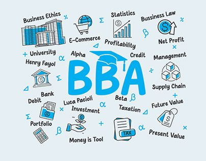

## What is this course?

Bachelor of Business Administration (BBA) is an undergraduate programme that introduces students to how organisations are started, managed and grown. It covers business functions such as marketing, finance, accounting, human resources, operations, economics and management. Students may learn through lectures, case studies, presentations, group assignments, internships and projects. Many colleges offer electives or specialisations in areas such as finance, analytics, entrepreneurship and international business. BBA is suitable for students from different Class 12 streams, subject to the college's eligibility rules. The degree can lead to entry-level business roles or further study such as an MBA.

## Eligibility

There is no single national percentage or subject combination that applies to every BBA programme.

- **Qualification:** Usually, candidates must have passed Class 12 or an equivalent examination from a recognised board.
- **Stream:** Many colleges accept students from any stream—Arts, Commerce or Science. Some specialised programmes may require Mathematics, Accountancy or another subject.
- **Minimum marks:** Requirements are set by each university or college. Some use an overall percentage; others use selected subjects or category-specific thresholds.
- **Entrance test:** If the programme requires CUET-UG, SET, NPAT or another test, applicants must meet the exam and university-specific rules.
- **Age and category rules:** These may apply depending on the institution and entrance exam.

**Examples from published 2026 admission information:**

- The CUET-UG 2026 programme list includes BBA programmes with a General Aptitude Test requirement and programme-specific Class 12 criteria.
- Symbiosis Centre for Management Studies, Bengaluru, lists Class 12 eligibility of 50% for Open category and 45% for SC/ST candidates for its BBA programme.
- VIT Business School's BBA page describes merit selection based on Class 12 marks, with no entrance examination.

These are examples, not universal BBA eligibility rules.

## Admission process and entrance exams

BBA admissions are institution-specific. The same entrance exam is not accepted by every college, and appearing for an exam does not automatically mean a candidate has applied to every participating institution.

### Common admission routes

| Route / exam                                | Where it applies                                                                                                       | What applicants should know                                                                                                                                                                                        |
| ------------------------------------------- | ---------------------------------------------------------------------------------------------------------------------- | ------------------------------------------------------------------------------------------------------------------------------------------------------------------------------------------------------------------ |
| **CUET-UG**                                 | Central universities and other participating universities that list BBA or a related programme for that admission year | Check the NTA programme list and the university's own subject mapping. A university may require the General Aptitude Test, a language paper, domain subjects or a combination.                                     |
| **SET**                                     | Specified Symbiosis undergraduate programmes, including BBA at SCMS Pune and certain other listed programmes           | Candidates must register for SET and separately complete the programme/institute application where required. Shortlisting and further selection may include Personal Interaction. SET is not a universal BBA exam. |
| **NPAT**                                    | Specified NMIMS undergraduate programmes, including its listed BBA variants                                            | Check the campus and programme list for the admission year. Programme options can include BBA, BBA FinTech, BBA Finance and other named variants.                                                                  |
| **IIMB Entrance Test / CUET-UG / JEE Main** | IIM Bangalore's BBA in Digital Business (DBE), as specified for its 2026 admission cycle                               | This is a programme-specific route. IIMB's 2026 admissions page accepted its own test, CUET-UG General Test or JEE Main, subject to its stated cut-offs and rules.                                                 |
| **Class 12 merit**                          | Colleges that explicitly publish a merit-based admission process                                                       | The college may prepare a rank list from Class 12 marks and conduct counselling or document verification.                                                                                                          |
| **Other university-level tests**            | Some private universities and institutions                                                                             | Always check the exact programme page and current prospectus.                                                                                                                                                      |

### Examples of which route applies

- **Symbiosis Centre for Management Studies, Pune:** SET is mandatory for the BBA programme listed in the official SET 2026 overview. Shortlisted candidates proceed to the institute's further selection process.
- **NMIMS:** NPAT is used for the BBA programmes listed on the official NPAT website. Confirm the specific campus and programme before applying.
- **VIT Business School, Vellore:** Its published BBA admission page states that there is no entrance examination and selection is based on Class 12 merit.
- **IIM Bangalore BBA in Digital Business:** Its 2026 admissions page listed the IIMB Entrance Test, CUET-UG General Test and JEE Main as accepted score routes.
- **University of Delhi:** The 2026–27 route for BMS and BBA(FIA) is through CUET-UG with programme-specific subject combinations. These are named programmes and should not be confused with a generic BBA degree.

### Step-by-step process

1. Make a shortlist of colleges and confirm the exact degree title: BBA, BBA (Hons), BBA-FIA, BMS or another named programme.
2. Read the latest eligibility criteria, including Class 12 subjects, marks and category conditions.
3. Register for the required entrance test, if any.
4. Submit a separate college or university application if the institution requires one.
5. Check the merit list, entrance score, shortlist or interview schedule.
6. Participate in counselling, personal interaction or document verification as directed.
7. Confirm the seat, pay the official fee and keep the receipt and admission documents.

### Official exam and admission portals

- CUET-UG: https://cuet.nta.nic.in/
- Symbiosis SET: https://www.set-test.org/
- NMIMS NPAT: https://npat.nmims.edu/
- IIM Bangalore BBA (Digital Business): https://dbe.iimb.ac.in/admissions/
- VIT Business School BBA: https://bschool.vit.ac.in/undergraduate/bba/
- University of Delhi: https://admission.uod.ac.in/

## Syllabus overview

The subjects and semester order differ by university. The outline below is a broad example of topics commonly found in BBA curricula, not a compulsory national syllabus.

| Year                            | Common subjects and learning areas                                                                                                                                                                  |
| ------------------------------- | --------------------------------------------------------------------------------------------------------------------------------------------------------------------------------------------------- |
| **First year**                  | Principles of Management, Business Communication, Financial Accounting, Business Economics, Business Mathematics or Statistics, Business Environment and introductory marketing.                    |
| **Second year**                 | Human Resource Management, Marketing Management, Financial Management, Cost and Management Accounting, Business Research Methods, Operations Management, Organisational Behaviour and Business Law. |
| **Third year**                  | Strategic Management, Entrepreneurship, International Business, Business Analytics, electives, internship, live projects and a final project or dissertation.                                       |
| **Fourth year (where offered)** | Advanced electives, research methods, dissertation or research project, internship and interdisciplinary courses under the university's Honours / Honours with Research structure.                  |

The actual course can include subjects such as taxation, e-commerce, supply chain, digital marketing, banking, business ethics and information systems. Check the current syllabus of the college before applying.

## Specializations

Colleges may offer a formal specialisation, a group of electives, a minor or a separate named BBA programme. Common areas include:

- **Finance:** Financial statements, investment basics, corporate finance, banking and financial planning.
- **Marketing:** Consumer behaviour, branding, advertising, sales and digital marketing.
- **Human Resource Management:** Recruitment, training, employee relations, performance and workplace policies.
- **Business Analytics:** Business statistics, data visualisation, decision-making and introductory analytics tools.
- **International Business:** Global trade, international markets, cross-border business and global strategy.
- **Entrepreneurship:** Business planning, start-up finance, innovation and venture development.
- **Operations and Supply Chain Management:** Procurement, logistics, inventory, quality and process management.
- **Digital Business:** E-commerce, digital platforms, product management and technology-enabled business models.
- **Retail and E-commerce:** Retail operations, merchandising, online sales and customer experience.
- **Banking and Insurance:** Financial services, banking operations, risk and insurance fundamentals.

Not every college offers all these areas. Check whether the specialisation appears on the official degree title or is only an elective option.

## Fee range: government vs private colleges

There is no single official fee range for all BBA colleges in India. Fees depend on the university, campus, course structure, facilities, residential status and admission category. Some public universities charge comparatively modest tuition, while private and deemed universities may charge higher programme fees.

| College type                     | Annual fee range                                                                                                                  |
| -------------------------------- | --------------------------------------------------------------------------------------------------------------------------------- |
| Government / public universities | **Not verified** as a reliable India-wide range. Check the university's current fee notice and any college-specific charges.      |
| Private / deemed universities    | **Not verified** as a reliable India-wide range. Check the official programme fee schedule for the campus and admission category. |

When comparing fees, calculate the full cost for the entire degree. Include tuition, admission and examination charges, student activity fees, refundable deposits, hostel, food, transport, laptop and internship-related expenses. Ask whether the annual fee is fixed or can increase in later years.

## Career options and typical starting salary

BBA graduates may apply for entry-level roles in business, sales, finance support, marketing, operations and customer-facing functions. The job title and salary depend on the student's skills, internships, college, location and employer.

Common entry-level roles include:

- Business development executive
- Sales executive or sales coordinator
- Marketing executive
- Digital marketing associate
- Human resources or recruitment coordinator
- Operations executive
- Customer success associate
- Retail or store operations executive
- Business analyst trainee (where quantitative and software skills are suitable)
- Finance or accounts assistant (with relevant accounting skills)

### Starting salary

A **reliable national starting-salary range specifically for BBA graduates is Not verified** from a comparable official government dataset. Any salary figure should be treated as an estimate, not a promise or a standard pay scale. Entry-level pay can differ substantially between sales, marketing, operations, finance support and analyst roles.

For a practical estimate, students should compare recent entry-level vacancies for the exact role and city on the Government of India's National Career Service (NCS) portal, and check whether the displayed amount is fixed salary, total CTC or includes incentives. NCS vacancy listings are live examples, not a national BBA salary survey.

Official reference: https://www.ncs.gov.in/

## Higher studies options

After BBA, students can consider:

- **MBA:** A common route for advanced study in management, finance, marketing, HR, operations, analytics or strategy.
- **M.Com:** For students who want deeper study in commerce, accounting, finance or related subjects, subject to admission eligibility.
- **M.A. / M.Sc. in Economics or related fields:** Where the student's undergraduate subjects meet the university's entry requirements.
- **Master's in Business Analytics, Finance or International Business:** Programme prerequisites vary by university.
- **Professional qualifications:** Such as CA, CMA, CS or other recognised finance and accounting pathways, subject to the relevant professional body's entry and examination rules.
- **Postgraduate diplomas and certifications:** In areas such as digital marketing, data analytics, financial markets, logistics or human resources. Check the provider's credibility and the qualification's recognition.

Under the UGC's 2025 minimum standards regulations, a three-year undergraduate degree and a four-year Honours / Honours with Research degree have different credit and progression structures. The regulations provide for postgraduate pathways according to the qualification earned; check the specific master's programme's eligibility rules.

## Skills you will learn

A BBA programme can help students develop:

- Business communication and presentation
- Teamwork and leadership
- Basic accounting and financial literacy
- Marketing and customer understanding
- Business planning and decision-making
- Data interpretation and business statistics
- Problem-solving and critical thinking
- Project management and time management
- Negotiation and professional networking
- Research, report writing and case analysis
- Understanding of business ethics and responsible management

Students can strengthen these skills through internships, student clubs, case competitions, live projects and practical work with spreadsheets and business software.

## Who should choose this course?

BBA may suit students who are curious about how companies work and enjoy communication, teamwork, planning, problem-solving and understanding customers or markets. It can be a useful starting point for students who want to explore management, entrepreneurship, marketing, finance or business operations before choosing a more focused career path.

Students do not need to have studied Commerce in Class 12 for many BBA programmes, but they should check each college's subject requirements. Those interested in finance or analytics may benefit from strengthening Mathematics, statistics and spreadsheet skills. Before enrolling, compare the curriculum, internships, faculty, industry exposure, placement disclosures, total fees and the recognition status of the university and programme.

## UGC and AICTE rules for BBA

### UGC

- The UGC (Minimum Standards of Instruction for the Grant of Undergraduate Degree and Postgraduate Degree) Regulations, 2025 provide for undergraduate degrees of **three or four years**, subject to the prescribed credit and qualification framework.
- Universities determine their curriculum, credits, assessment and programme structure within the applicable UGC framework.
- A three-year BBA and a four-year BBA (Honours / Honours with Research) may therefore both be offered, depending on the university's approved programme structure.
- For an online or distance BBA, students must verify that the specific university and programme are recognised/entitled by UGC's Distance Education Bureau for the exact academic session. Recognition in one year does not automatically prove recognition for the next session.

### AICTE

- AICTE's Approval Process Handbook 2024–25 to 2026–27 contains provisions relating to management programmes, including BBA/BMS, and the applicable institutional requirements depend on the type of institution and programme.
- UGC's public notice dated 23 January 2024 specifically states that institutions intending to offer BBA, BMS or BCA in **Open and Distance Learning (ODL) or Online mode** must obtain AICTE approval/recommendation and submit it to UGC for the relevant recognition/entitlement process from academic year 2024–25 onwards.
- Do not assume that an AICTE approval rule for online/ODL programmes applies identically to every regular on-campus BBA. For a regular programme, check the university's legal status, affiliation/recognition, applicable AICTE handbook provisions and the institution's own disclosures.
- For online and distance programmes, check both the UGC-DEB recognition for the exact academic session and any required AICTE recommendation/approval. Avoid enrolling through an unauthorised franchise or study centre.

Official regulatory sources:

- UGC regulations: https://www.ugc.gov.in/regulations/
- UGC Distance Education Bureau: https://deb.ugc.ac.in/
- AICTE: https://www.aicte-india.org/
- AICTE Approval Process Handbook 2024–25 to 2026–27: https://gujacpc.admissions.nic.in/document/aicte-approval-process-handbook-2024-25-to-2026-27/

## Frequently asked questions

### 1. Is CUET-UG compulsory for BBA admission?

No. CUET-UG is required only by universities and programmes that specify it. Other colleges may use SET, NPAT, their own entrance tests or Class 12 merit. Always check the exact programme's current admission notice.

### 2. Which colleges use SET or NPAT for BBA?

Symbiosis uses SET for specified programmes, including BBA at SCMS Pune as listed in the official SET 2026 overview. NMIMS uses NPAT for the BBA programmes listed on its official NPAT website. The campus and programme list can change by admission year.

### 3. Can students from Arts or Science take BBA?

Many BBA programmes accept students from any Class 12 stream. However, some courses require Mathematics, Accountancy or other specific subjects. Check the programme's eligibility before applying.

### 4. Is BBA a three-year or four-year degree?

Both structures are available. Many colleges offer a three-year BBA, while some universities offer a four-year Honours or Honours with Research route under their undergraduate framework. The UGC's 2025 regulations provide for three- and four-year undergraduate degree structures.

### 5. Is AICTE approval compulsory for every BBA college?

Do not apply one blanket answer to every BBA. AICTE requirements depend on the institution type and mode. UGC's 2024 public notice specifically requires AICTE approval/recommendation for BBA programmes offered in ODL or online mode. For a regular on-campus course, verify the university's recognition/affiliation and the applicable AICTE provisions for that institution.

## Sources

1. **UGC — Minimum Standards of Instruction for the Grant of Undergraduate Degree and Postgraduate Degree Regulations, 2025.** Degree duration, credits and progression framework.  
   https://www.ugc.gov.in/pdfnews/5576784_UG-and-PG-Regulations-2025.pdf
2. **UGC — Regulations page.** Official listing of current UGC regulations.  
   https://www.ugc.gov.in/regulations/
3. **UGC Distance Education Bureau — Public Notice dated 23 January 2024.** AICTE approval/recommendation for BBA, BMS and BCA in ODL/online mode.  
   https://deb.ugc.ac.in/Uploads/Notices_Upload/UGC_20240123171626_1.pdf
4. **UGC Distance Education Bureau — recognised/entitled HEI programme list.** Check the exact session and programme before enrolling in online or distance BBA.  
   https://deb.ugc.ac.in/Home/HEI_Prog_List
5. **AICTE — Approval Process Handbook 2024–25 to 2026–27.**  
   https://gujacpc.admissions.nic.in/document/aicte-approval-process-handbook-2024-25-to-2026-27/
6. **NTA — CUET-UG 2026 official programme list and notices.**  
   https://cuet.nta.nic.in/  
   https://nta.ac.in/
7. **Symbiosis — SET 2026 overview.** Lists the BBA programmes for which SET applies and explains shortlisting and institute-level selection.  
   https://www.set-test.org/overview
8. **NMIMS — NPAT 2026 official website.** Lists the undergraduate BBA programmes using NPAT.  
   https://npat.nmims.edu/
9. **IIM Bangalore — BBA in Digital Business admissions 2026.** Accepted test routes, cut-offs and fee information for that specific programme.  
   https://dbe.iimb.ac.in/admissions/
10. **VIT Business School — BBA admission page.** Merit-based admission and fee information published by the institution.  
    https://bschool.vit.ac.in/undergraduate/bba/
11. **University of Delhi — Shaheed Sukhdev College of Business Studies admissions FAQ 2026.** CUET-UG route and programme-specific subject combination for BMS and BBA(FIA).  
    https://sscbs.du.ac.in/faqs-for-bms-bba-fia-b-sc-c-s-admissions-2026/
12. **Government of India — National Career Service.** Current job listings for checking entry-level role requirements and advertised pay; not a national BBA salary survey.  
    https://www.ncs.gov.in/

## Not verified

- A single India-wide annual BBA fee range for government/public colleges.
- A single India-wide annual BBA fee range for private/deemed universities.
- A reliable national average or typical starting salary range specifically for BBA graduates.
- A single national BBA entrance examination or a universal eligibility percentage.
- One uniform BBA syllabus followed by all Indian universities.
- The exact AICTE approval position for every individual regular on-campus BBA institution; it must be checked against the institution type and applicable current handbook.
- Admission dates, cut-offs, subject mappings and fee schedules for the 2027–28 cycle as of 24 November 2026.
- Availability of every listed specialisation at any particular college; offerings differ by institution and year.
