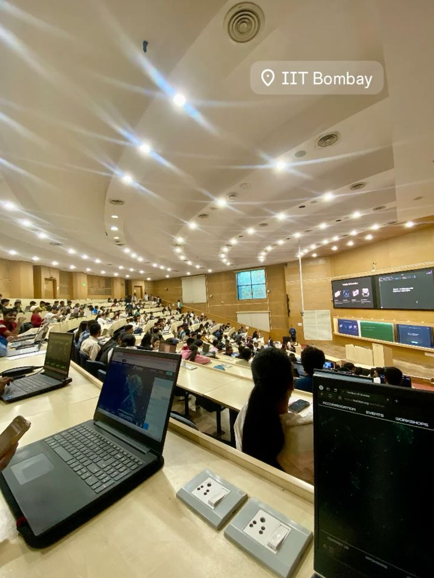
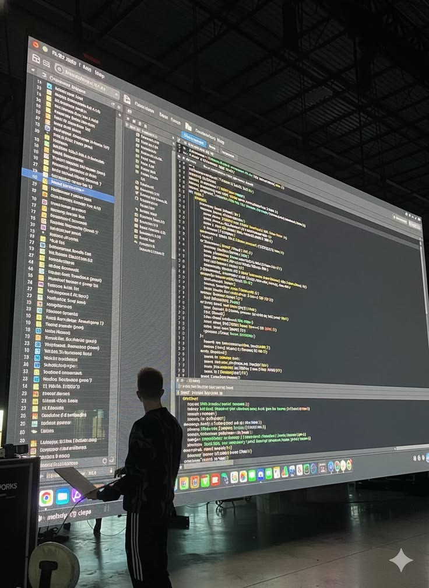

## What is this course?

B.Tech in Computer Science and Engineering is a four-year engineering degree that teaches students how computers, software and digital systems are designed and built. Students learn programming, data structures, algorithms, databases, computer networks, operating systems and software development. The course combines mathematics and engineering fundamentals with practical work such as coding assignments, laboratory sessions, projects and internships. Many colleges also offer electives in areas such as artificial intelligence, data science and cybersecurity. The exact subjects and order can differ between universities, so students should check the curriculum of each college before applying.

## Eligibility

The general entry route is completion of Class 12 or an equivalent qualification. The exact subject combination and marks requirement must be checked in the current admission notice of the college, university or counselling authority.

- **Subjects:** AICTE's Approval Process Handbook 2024–2027 lists Physics and Mathematics as mandatory subjects for Computer Science and Engineering. It allows the remaining subject to be selected from the subjects listed in its handbook.
- **Minimum marks:** The AICTE handbook gives a general benchmark of 45% in the qualifying subjects (40% for reserved-category candidates), but the applicable admission authority and institution rules must be checked.
- **Diploma route:** Some institutions provide lateral entry to the second year for eligible diploma holders. Availability and eligibility differ by state and institution.
- **Other conditions:** Domicile, category, board-equivalence and subject-specific requirements may apply for state counselling or individual colleges.

Do not assume that the same eligibility rule applies to every entrance exam or every college.

## Admission process and entrance exams

A typical admission process looks like this:

1. **Choose colleges and check their rules.** Confirm that the college offers B.Tech CSE, and check its approved intake, eligibility, fee notice and accepted entrance exams.
2. **Apply for the relevant entrance exam.** Register through the official exam website before its deadline.
3. **Write the exam and check the result.** Follow the official instructions for admit cards, exam day, answer keys and scorecards.
4. **Register for counselling.** A qualifying exam score does not by itself guarantee a seat. Complete the separate counselling or college application process.
5. **Fill choices and participate in seat allotment.** Check the seat-allocation rules, reservation provisions and document requirements.
6. **Accept the seat and complete admission.** Pay the prescribed fee and report or complete online verification as instructed by the authority.

### Entrance exams to know

| Exam                              | Where it is used                                                                                     | Important points                                                                                                                                                                                                                                                                       |
| --------------------------------- | ---------------------------------------------------------------------------------------------------- | -------------------------------------------------------------------------------------------------------------------------------------------------------------------------------------------------------------------------------------------------------------------------------------- |
| **JEE Main**                      | NITs, IIITs and other participating institutions; also used as the qualifying route for JEE Advanced | NTA conducts JEE Main. The participating institute and counselling rules determine the seats available through the score.                                                                                                                                                              |
| **JEE Advanced**                  | IIT undergraduate engineering admissions                                                             | Candidates first need to meet the JEE Main shortlisting condition and all other JEE Advanced eligibility rules. IIT seat allocation is conducted through the applicable JoSAA process.                                                                                                 |
| **KCET / UGCET**                  | Eligible Karnataka engineering seats and participating colleges                                      | Conducted by the Karnataka Examinations Authority (KEA). Karnataka eligibility clauses, domicile rules, seat categories and counselling conditions matter.                                                                                                                             |
| **MHT CET**                       | Maharashtra engineering and technology admissions                                                    | The Maharashtra State CET Cell conducts the exam. Its 2026–27 brochure includes first-year engineering admissions and separate candidature rules. For All India candidates, the 2026 brochure states that JEE Main scores are preferred over MHT CET scores for B.E./B.Tech admission. |
| **Other state / institute exams** | Depending on the state or college                                                                    | Some states and private or deemed universities use their own entrance exams, national exam scores or more than one route. Confirm directly with the institution.                                                                                                                       |

**2027 admission note (checked 24 November 2026):** NTA has published JEE Main 2027 documents. JEE Advanced 2027 eligibility information has also been published. The final dates, eligibility and counselling schedules for KCET 2027 and MHT CET 2027 should be checked on the respective official portals when their full notices are released. Do not rely on dates from an earlier admission cycle.

Official portals:

- JEE Main: https://jeemain.nta.nic.in/
- JEE Advanced: https://jeeadv.ac.in/
- Karnataka Examinations Authority: https://cetonline.karnataka.gov.in/kea/
- Maharashtra State CET Cell: https://cetcell.mahacet.org/

## Syllabus overview

The following is a broad guide, not a fixed national semester-wise syllabus. AICTE's CSE model curriculum is a reference framework; universities may adjust course titles, credits, electives and semester order.

| Year            | Common areas of study                                                                                                                                                                                                        |
| --------------- | ---------------------------------------------------------------------------------------------------------------------------------------------------------------------------------------------------------------------------- |
| **First year**  | Engineering mathematics, physics or other basic sciences, basic electrical/electronics engineering, engineering graphics or workshop practice, introductory programming, communication and foundational engineering courses. |
| **Second year** | Object-oriented programming, data structures, algorithms, discrete mathematics, digital logic, computer organisation, database management systems and basic computer networks.                                               |
| **Third year**  | Operating systems, theory of computation, software engineering, design and analysis of algorithms, computer networks, web technologies, electives and project work.                                                          |
| **Fourth year** | Advanced electives, major project, internship or industry training, seminars and subjects selected from areas such as AI, data science, security or distributed computing.                                                   |

The actual curriculum can differ significantly. Review the latest syllabus published by the college or affiliating university.

## Specializations

CSE students may be able to choose electives, a minor, a concentration or a separate named programme in areas such as:

- **Artificial Intelligence and Machine Learning:** Building systems that identify patterns, make predictions or perform tasks using data.
- **Data Science and Big Data:** Collecting, processing and analysing large datasets.
- **Cybersecurity:** Protecting computers, networks, applications and information from attacks.
- **Cloud Computing and Distributed Systems:** Developing services that run across connected computers and cloud platforms.
- **Internet of Things (IoT):** Connecting sensors, devices and software to collect and exchange information.
- **Software Engineering:** Planning, building, testing and maintaining software systems.
- **Computer Vision and Robotics:** Enabling computers or machines to interpret images and interact with the physical world.

Not every college offers every specialization. Check whether it is a formal degree title, a department, a minor or simply an elective group.

## Fee range: government vs private colleges

There is no single official fee band for all government or all private engineering colleges in India. Fees can depend on the state, institution, admission quota, category, hostel choice and the year of admission. A government-quota seat in a private college may have a different fee from a management-quota seat in the same college.

| College type        | Annual tuition fee range                                                                                                                                                         |
| ------------------- | -------------------------------------------------------------------------------------------------------------------------------------------------------------------------------- |
| Government colleges | **Not verified** as a reliable India-wide range. Check the relevant state fee order or the college's official fee notice.                                                        |
| Private colleges    | **Not verified** as a reliable India-wide range. Fees vary widely by institution and seat category; check the official fee schedule for the exact programme and admission route. |

When comparing costs, ask for the full four-year estimate, not just the tuition figure. Check whether the published amount includes admission charges, examination fees, deposits, hostel, food, transport, laptop or other required expenses. Also check whether fees can increase in later years.

## Career options and typical starting salary

Graduates can apply for roles such as:

- Software developer or software engineer
- Front-end, back-end or full-stack developer
- Data analyst
- Junior data engineer
- Quality assurance (QA) or software test engineer
- Systems or network engineer
- Cybersecurity analyst
- Cloud or DevOps associate
- Application support or technical consultant
- Research or engineering roles after gaining relevant experience or further qualifications

### Starting salary

**A dependable India-wide starting salary range specifically for B.Tech CSE graduates is Not verified.** Pay varies with the employer, job role, location, skills, internship experience, college and hiring market. A single number can be misleading.

The Ministry of Education's NIRF portal publishes institution-level placement information, including median salary data submitted by participating institutions. These figures are not a national CSE-only salary average and may cover more than one branch. Use the latest NIRF data for the particular college and check the programme-level placement report, if the college publishes one. Treat advertised highest packages as exceptional outcomes, not as a typical starting salary.

Official reference: https://www.nirfindia.org/Rankings/2025/EngineeringRanking.html

## Higher studies options

After B.Tech CSE, students may consider:

- **M.Tech / M.E. in CSE or a related area:** For advanced technical study and research.
- **M.S. in India or abroad:** Depending on university requirements and the student's academic profile.
- **MCA:** A postgraduate computing option; eligibility and relevance should be checked against the chosen institution and career plan.
- **MBA:** For students interested in management, product, consulting, operations or entrepreneurship.
- **Ph.D.:** For research and academic careers, usually after meeting the university's postgraduate or other entry requirements.
- **Professional certifications:** In areas such as cloud platforms, networking, cybersecurity or data tools. Check the issuing organisation and the practical value of each certification.

## Skills you will learn

A CSE programme can help students develop:

- Programming and debugging
- Logical reasoning and computational thinking
- Data structures and algorithm design
- Database design and data handling
- Operating system and networking fundamentals
- Software design, testing and documentation
- Teamwork through group projects
- Technical communication and presentations
- Problem-solving through projects and practical assignments
- Independent learning as tools and technologies change

Students should build practical skills alongside classroom learning through projects, internships, coding practice and collaborative work.

## Who should choose this course?

B.Tech CSE may suit students who enjoy mathematics, logical problem-solving, technology and learning how software works. It is useful to be curious and willing to practise regularly, because programming skills develop through repeated problem-solving rather than memorising theory alone.

You do not need to be an expert programmer before joining. However, students should be prepared to spend time learning programming languages, debugging errors, understanding abstract concepts and completing projects. Before choosing a college, compare its curriculum, faculty, laboratories, internship support, placement disclosures, total fees and student support facilities.

## Frequently asked questions

### 1. Is Mathematics compulsory for B.Tech CSE?

AICTE's Approval Process Handbook 2024–2027 lists Physics and Mathematics as mandatory subjects for CSE at the 10+2 level. Always check the current rules of the specific college and admission authority.

### 2. Is JEE Main enough to get into an IIT?

No. For the regular IIT undergraduate admission route, candidates must qualify for and appear in JEE Advanced, meeting its eligibility conditions. JEE Main performance is used for shortlisting candidates for JEE Advanced.

### 3. Can I get B.Tech CSE admission through KCET?

Yes, KCET/UGCET is used for eligible engineering admissions in Karnataka. Eligibility clauses, domicile conditions, seat categories, college participation and counselling rules apply. Check the current KEA bulletin.

### 4. Is MHT CET accepted outside Maharashtra?

MHT CET is primarily the Maharashtra state entrance examination. The 2026–27 brochure also describes All India candidature and says JEE Main scores are preferred over MHT CET scores for All India candidates seeking B.E./B.Tech admission. Check the current brochure and counselling rules before applying.

### 5. Is B.Tech CSE better than B.Tech IT?

Neither is automatically better for every student. CSE usually covers a broad range of computing foundations, while Information Technology programmes may place a different emphasis on applying and managing computing systems. The actual difference depends on the college's syllabus, electives, projects and faculty. Compare the curriculum rather than choosing by the course name alone.

## Sources

The following are official government, regulator, examination or institutional sources. Rules and dates can change; use the notice for the admission year in which you apply.

1. **AICTE — Approval Process Handbook 2024–2027** (engineering duration and entry-level eligibility):  
   https://aicte.gov.in/sites/default/files/APH%20Final.pdf
2. **AICTE — Model Curriculum for UG Degree Course in Computer Science and Engineering (2022)**:  
   https://www.aicte.gov.in/sites/default/files/Updated-AICTE%20-%20UG%20CSE.pdf
3. **NTA — JEE Main official website and 2027 documents**:  
   https://jeemain.nta.nic.in/  
   https://jeemain.nta.nic.in/documents/
4. **JEE Advanced — official website and 2027 eligibility**:  
   https://jeeadv.ac.in/  
   https://jeeadv.ac.in/eligibility.html
5. **Karnataka Examinations Authority (KEA) — official website**:  
   https://cetonline.karnataka.gov.in/kea/
6. **Maharashtra State Common Entrance Test Cell — official website and information brochures**:  
   https://cetcell.mahacet.org/  
   https://cetcell.mahacet.org/cet-3/
7. **Ministry of Education — NIRF 2025 Engineering ranking and institutional data links**:  
   https://www.nirfindia.org/Rankings/2025/EngineeringRanking.html

## Not verified

- A single India-wide annual tuition fee range for government B.Tech CSE colleges.
- A single India-wide annual tuition fee range for private B.Tech CSE colleges.
- A national average starting salary or a reliable CSE-only starting salary range.
- One common syllabus followed by every Indian university; curricula differ by institution.
- Final KCET 2027 and MHT CET 2027 dates, full eligibility and counselling schedules as of 24 November 2026.
- Whether a particular college offers each specialization listed above; availability must be checked with that college.
