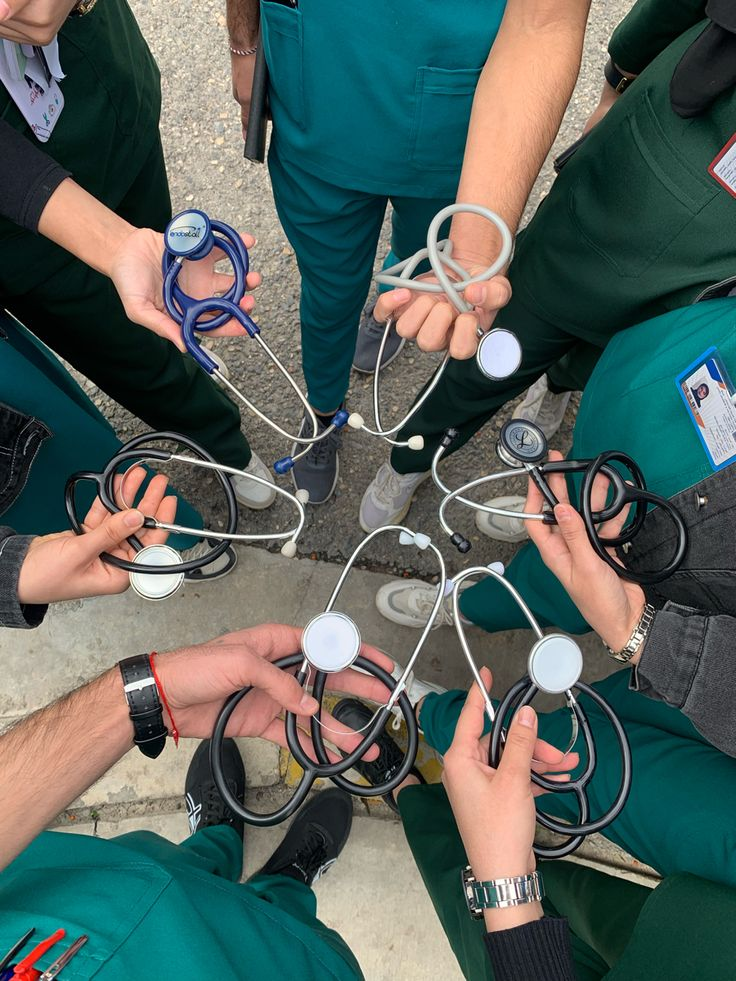
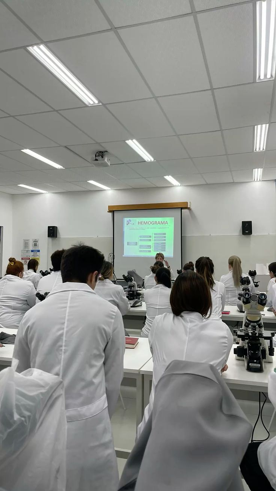

## What is this course?

MBBS (Bachelor of Medicine and Bachelor of Surgery) is the main undergraduate medical degree for students who want to become doctors in modern scientific medicine in India. It combines classroom learning, laboratory work, clinical postings and supervised patient care. Students study the normal functioning of the human body, diseases, diagnosis, treatment, prevention, public health and medical ethics. The course includes hospital-based clinical training and ends with a compulsory rotating internship. After completing the required examinations and internship, graduates can pursue registration under the applicable medical registration rules. Many doctors then study further to specialise in a medical or surgical field.

## Eligibility

The details below are based on the **NEET-UG 2026 Information Bulletin** and NMC regulations. Always read the bulletin and counselling prospectus for the admission year in which you apply.

### Academic qualification

- Candidates should have passed or be appearing in Class 12 or an equivalent qualifying examination.
- The required subjects are **Physics, Chemistry, Biology or Biotechnology, and English**. The bulletin recognises specified equivalent examinations and, subject to documentary proof, permits the required subjects to have been studied as additional subjects after Class 12.
- A candidate whose Class 12 result is awaited may appear for NEET-UG, but cannot be admitted unless the qualifying examination is passed by the applicable counselling/admission deadline.
- Foreign, NRI and OCI candidates must check the additional documentation and eligibility rules applicable to their category and the college/state.

### Age

- The candidate must have completed **17 years on or before 31 December of the year of the NEET-UG examination**.
- The NEET-UG 2026 bulletin states that there is **no upper age limit**.

### NEET qualifying percentile

For MBBS admission, the 2026 bulletin specifies the following minimum NEET percentile requirements:

| Category                                                     | Minimum qualifying percentile |
| ------------------------------------------------------------ | ----------------------------: |
| General / General-EWS                                        |               50th percentile |
| SC / ST / OBC-NCL                                            |               40th percentile |
| General / General-EWS candidates with benchmark disabilities |               45th percentile |
| SC / ST / OBC-NCL candidates with benchmark disabilities     |               40th percentile |

A qualifying percentile only makes a candidate eligible to take part in the admission process. It does **not** guarantee a seat. Actual admission depends on rank, seat availability, reservation rules, choices, eligibility and counselling allotment.

### Seat and reservation rules

- NMC publishes the approved MBBS college and intake information. Candidates should check the latest official seat matrix for the relevant academic year and confirm that the college and intake are approved.
- The **15% All India Quota (AIQ)** in participating state government medical colleges is handled through MCC. The remaining state quota seats are generally handled by the respective state/UT counselling authority, subject to the applicable rules.
- MCC also handles specified seats such as 100% MBBS seats of AIIMS, 100% BHU open seats, specified central university/institution seats, and 100% seats of deemed universities (including the notified NRI seats).
- State quota eligibility can include domicile, schooling, residence or other state-specific conditions. These conditions are not identical across India.
- Central reservation rules apply to the relevant AIQ and central-institution seats; state reservation rules apply to state quota seats. Read the counselling prospectus for the exact seat category.

## Admission process and entrance exams

### Main entrance exam: NEET-UG

NEET-UG, conducted by the National Testing Agency (NTA), is the common entrance examination for MBBS admission in India. Candidates must qualify NEET-UG and then separately register for the counselling process applicable to the seats they want.

Official websites:

- NTA / NEET: https://neet.nta.nic.in/
- MCC UG counselling: https://mcc.nic.in/ug-medical-counselling/
- National Medical Commission: https://www.nmc.org.in/

### How admission works

1. **Check eligibility.** Read the current NTA information bulletin and confirm your Class 12 subjects, age and category documents.
2. **Apply for NEET-UG.** Complete the NTA application, upload the required documents and pay the examination fee within the notified dates.
3. **Write NEET-UG.** Download the admit card, attend the examination and check the official result and All India Rank.
4. **Register for counselling.** Register separately on the MCC portal for MCC-managed seats and on the relevant state/UT counselling portal for state-managed seats. A NEET application is not a counselling registration.
5. **Fill and lock college choices.** Check the college, course, quota, fee, bond/service conditions, hostel costs and approved intake before listing preferences.
6. **Check allotment results.** Follow the official round-wise schedule and instructions. If allotted a seat, download the allotment letter and complete reporting/document verification as directed.
7. **Complete admission.** Pay the prescribed fees and submit original documents as required. Follow the rules for upgradation, resignation, forfeiture and later rounds before taking any action.

### Who conducts which counselling?

| Seat type                                                                 | Counselling authority                                    |
| ------------------------------------------------------------------------- | -------------------------------------------------------- |
| 15% All India Quota MBBS seats in participating state medical colleges    | MCC / DGHS                                               |
| 100% MBBS seats in AIIMS                                                  | MCC                                                      |
| 100% open seats in BHU and specified central university/institution seats | MCC, as specified in the bulletin                        |
| 100% seats in deemed universities, including the notified NRI seats       | MCC                                                      |
| State quota seats in state government medical colleges                    | Respective state/UT counselling authority                |
| State quota and other notified seats in private medical colleges          | Respective state/UT counselling authority, as applicable |

**Important:** MCC's seat coverage is not limited to the 15% AIQ. It also includes the central, national-institute and deemed-university seat categories specified in the current bulletin. Candidates should not assume that every seat in every private college is handled by MCC.

### Current process reference

As of **24 November 2026**, MCC's UG portal is displaying 2026 counselling activity, including later-round notices and allotment updates. The 2026 NTA bulletin and MCC portal are therefore the current reference for the 2026 admission cycle. For a future admission cycle, use that year's new bulletin and counselling notices rather than reusing old dates or round schedules.

## Syllabus overview

The NMC Competency Based Medical Education (CBME) Curriculum 2024 applies from the 2024–25 MBBS batch onwards. It divides the 4½ academic years into professional phases, followed by one year of compulsory rotating medical internship.

| Phase / period                                    |  Duration | Main subjects and learning areas                                                                                                                                                                                                   |
| ------------------------------------------------- | --------: | ---------------------------------------------------------------------------------------------------------------------------------------------------------------------------------------------------------------------------------- |
| **Phase I**                                       | 12 months | Anatomy, Physiology, Biochemistry, introduction to Community Medicine, foundation course, early clinical exposure, communication, ethics and professional behaviour.                                                               |
| **Phase II**                                      | 12 months | Pathology, Pharmacology, Microbiology, Community Medicine, Forensic Medicine and Toxicology, introduction to clinical subjects and clinical postings.                                                                              |
| **Phase III Part I**                              | 12 months | Community Medicine, Forensic Medicine and Toxicology, Medicine and allied subjects, Surgery and allied subjects, Paediatrics, Obstetrics and Gynaecology, ENT, Ophthalmology and clinical postings.                                |
| **Phase III Part II**                             | 18 months | General Medicine and allied specialties, General Surgery and allied specialties, Orthopaedics, Paediatrics, Obstetrics and Gynaecology, Psychiatry, Dermatology, Anaesthesiology, Radiodiagnosis, clinical postings and electives. |
| **Compulsory rotating medical internship (CRMI)** | 12 months | Supervised practical rotations through clinical departments and health facilities, with a logbook and required competencies.                                                                                                       |

The internship is a compulsory part of undergraduate medical education. NMC's CRMI Regulations require a minimum of 12 months. The 4½-year academic period plus one-year internship gives the standard **5½-year pathway**. Delays due to examinations, attendance or other permitted extensions can make an individual student's total time longer.

## Specializations (postgraduate options after MBBS)

MBBS is a general medical qualification. Students who want to specialise usually pursue postgraduate training after completing the required internship and meeting the relevant registration and entrance requirements.

### MD options

- General Medicine
- Paediatrics
- Dermatology, Venereology and Leprosy
- Psychiatry
- Radiodiagnosis
- Anaesthesiology
- Respiratory Medicine
- Pathology
- Pharmacology
- Microbiology
- Community Medicine
- Emergency Medicine
- General specialities and other recognised MD disciplines

### MS options

- General Surgery
- Orthopaedics
- Obstetrics and Gynaecology
- Ophthalmology
- Otorhinolaryngology (ENT)

### Other postgraduate routes

- **DNB:** Broad-speciality postgraduate training in recognised hospitals and institutions.
- **Diplomate / postgraduate programmes:** Availability and recognition depend on the current NMC/NBEMS rules.
- **Super-speciality training:** After an eligible postgraduate qualification, doctors may pursue DM or MCh programmes, subject to the applicable entrance and eligibility rules.

The list is indicative, not a promise that every college offers every subject. Course names, seats and entry rules can change. Check NMC and NBEMS notices for the current recognised programmes and examinations.

## Fee range: government vs private colleges

There is no single national MBBS fee schedule. Fees are set or regulated through different state and institutional processes, and may differ by quota within the same college. The annual cost can also include hostel, mess, deposits, university/examination charges, insurance and other items.

| College type                | Annual tuition fee range                                                                                                                   |
| --------------------------- | ------------------------------------------------------------------------------------------------------------------------------------------ |
| Government medical colleges | **Not verified** as one reliable India-wide range. Fees differ by state, college and quota.                                                |
| Private medical colleges    | **Not verified** as one reliable India-wide range. Fees differ by state, college, management category, NRI category and counselling rules. |

Before selecting a seat, download the official fee order or fee schedule for the exact college, course, quota and academic year. Confirm whether the amount is annual or semester-wise, whether it can increase, and whether there is a compulsory service bond or penalty for leaving the course. Do not rely only on an online advertisement or an unofficial fee list.

## Career options and typical starting salary

After completing MBBS, passing the required examinations and completing the compulsory internship, graduates may pursue the relevant registration process and explore roles such as:

- Junior Resident in a teaching hospital
- Medical Officer in a government or private hospital
- General Duty Medical Officer
- Casualty or emergency medical officer
- Primary health centre or community health service doctor
- Research assistant or clinical research roles, where eligible
- Public health roles after gaining the required additional training or qualifications
- Postgraduate medical training through an eligible route

### Starting salary: estimate and official reference

A dependable **India-wide starting salary range for all MBBS graduates is Not verified**. Pay differs by state, employer, hospital, job title, duty hours, experience, location and whether the role is a residency, contractual appointment or permanent government post.

One official public-sector reference is the **UPSC Combined Medical Services Examination 2026** notice. It lists Level 10 pay-matrix posts for certain medical officer roles, with a basic pay scale beginning at **₹56,100 per month** (plus applicable allowances such as NPA where admissible). This is an example of a specific government recruitment pay scale, **not** a national average or a guaranteed starting salary for every MBBS graduate. Private hospital and residency salaries can be different.

Official source: https://upsc.gov.in/ (Combined Medical Services Examination 2026 notice)

## Higher studies options

After MBBS and the required internship, graduates can consider:

- **MD or MS:** Broad-speciality postgraduate medical degrees, generally through the applicable NEET-PG counselling route.
- **DNB:** Postgraduate broad-speciality training through NBEMS-recognised programmes and the applicable admission process.
- **Diploma / other recognised postgraduate programmes:** Only where the programme and qualification are currently recognised under the relevant rules.
- **DM or MCh:** Super-speciality degrees after completing the required feeder postgraduate qualification and entrance process.
- **MPH (Master of Public Health):** For students interested in public health, epidemiology, health policy and population health.
- **Clinical research or medical education:** Further qualifications may support careers in research, teaching and healthcare administration.

Always verify the current entrance examination, eligibility, recognised institution and course status before applying.

## Skills you will learn

MBBS training aims to develop:

- Medical knowledge of the human body and common diseases
- Clinical history-taking and physical examination
- Basic diagnostic reasoning and interpretation of investigations
- Patient communication and counselling
- Clinical procedures and practical skills under supervision
- Emergency response and initial patient management
- Infection prevention and patient safety
- Medical ethics, consent and confidentiality
- Teamwork with nurses, technicians and other healthcare professionals
- Community health awareness and preventive care
- Professional conduct, record keeping and lifelong learning

## Who should choose this course?

MBBS may suit students who are genuinely interested in human health, biology, patient care and solving clinical problems. It requires sustained study, practical training, emotional maturity and the ability to communicate respectfully with people from different backgrounds.

Students should understand that MBBS is a long professional course. It includes demanding examinations, hospital postings, night or emergency duties during training and a compulsory internship. A student should choose it because they want to learn medicine and care for patients, not only because of social status or family pressure. Before joining, compare the college's recognition and approved intake, attached teaching hospital, clinical exposure, faculty, hostel, fees and service-bond conditions.

## Frequently asked questions

### 1. Is NEET-UG compulsory for MBBS admission in India?

Yes. NEET-UG is the common entrance examination for undergraduate MBBS admission in India. Qualifying NEET is only the first step; candidates must also take part in the applicable MCC or state/UT counselling process.

### 2. Is MBBS a 5-year or 5.5-year course?

The standard NMC structure is 4½ academic years followed by one year of compulsory rotating medical internship. Together, this is 5½ years. Individual completion time may be longer if examinations, attendance or other permitted requirements are delayed.

### 3. Does MCC conduct counselling for all MBBS seats?

No. MCC handles 15% AIQ seats in participating state colleges and specified categories such as AIIMS, deemed universities and certain central institutions. State and UT authorities handle their respective state-level seats, including many state quota seats in government and private colleges.

### 4. Does qualifying NEET guarantee an MBBS seat?

No. The qualifying percentile is only the minimum threshold to be eligible for admission consideration. A seat depends on the candidate's rank, category, preferences, seat availability, eligibility for the quota and the outcome of counselling.

### 5. Can I become a specialist immediately after MBBS?

MBBS is the basic medical degree. To become a specialist, graduates generally need further recognised postgraduate training such as MD, MS or DNB, followed by any required additional training for a super-speciality. The applicable entrance and registration rules must be checked for the year of application.

## Sources

1. **National Medical Commission — Competency Based Medical Education (CBME) Curriculum 2024.** Includes the 4½-year academic structure, phase durations and subject distribution.  
   https://www.nmc.org.in/wp-content/uploads/2026/02/12bCompetencyBasedMedicalEducationCBMECurriculum12092024.pdf
2. **National Medical Commission — Compulsory Rotating Medical Internship Regulations, 2021.** Requires a minimum 12-month internship.  
   https://www.nmc.org.in/MCIRest/open/getDocument?path=%2FDocuments%2FPublic%2FPortal%2FE_Compendium_of_NMC_2020_23%2FRegulations.pdf
3. **National Medical Commission — What's New / official notices.** Includes the latest undergraduate MBBS seat-matrix notices.  
   https://www.nmc.org.in/  
   https://nmc.org.in/whats-new
4. **National Testing Agency — NEET-UG 2026 Information Bulletin.** Eligibility, age, qualifying percentile, counselling responsibilities and MCC seat categories.  
   https://nta.gov.in/cms/uploads/neet_Information_Bulletin_2026_6aee60b758.pdf  
   https://neet.nta.nic.in/
5. **Medical Counselling Committee — UG Medical Counselling 2026.** Current counselling notices, schedules, registration and allotment information.  
   https://mcc.nic.in/ug-medical-counselling/
6. **Union Public Service Commission — Combined Medical Services Examination 2026 notice.** Official pay-matrix reference for selected government medical officer posts.  
   https://upsc.gov.in/

## Not verified

- A single national annual MBBS tuition-fee range for government medical colleges.
- A single national annual MBBS tuition-fee range for private medical colleges.
- A reliable India-wide average or typical starting salary range for all MBBS graduates.
- One fixed total cost of MBBS including hostel, mess, deposits, books and other college charges.
- A single nationwide state-quota domicile rule; these are set by the respective state/UT authorities.
- A fixed number of MBBS seats for all of India beyond the latest official NMC seat matrix for the specific academic year. Seat approvals and counselling matrices can be updated during the admission cycle.
- 2027 NEET-UG dates, counselling dates, seat matrix and fee schedules as of 24 November 2026.
