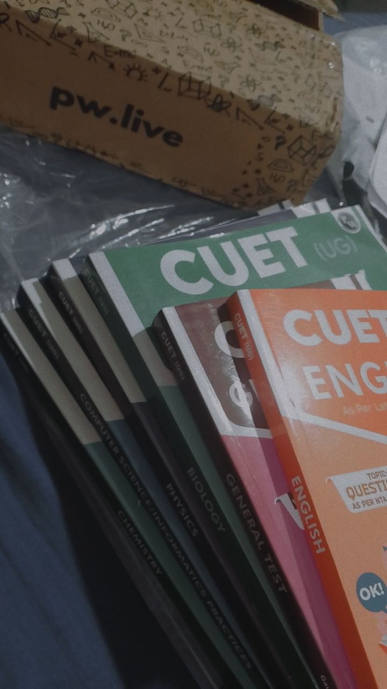
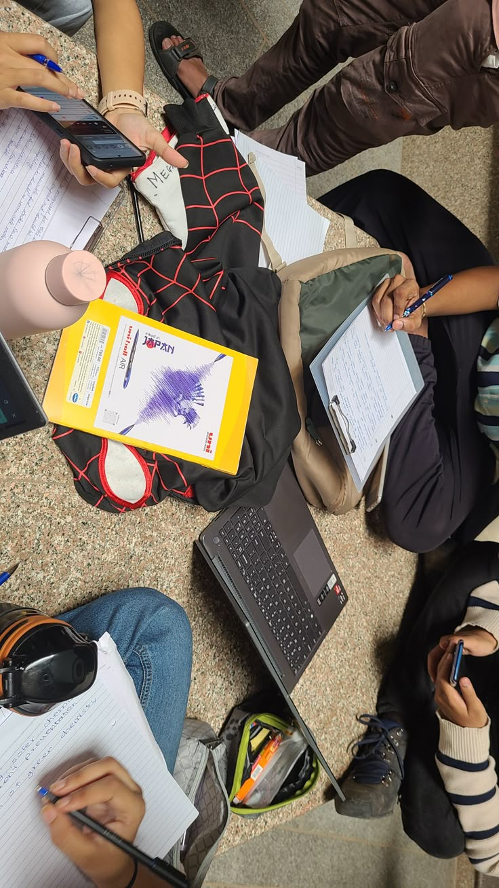

> **Cycle note:** This page covers the upcoming CUET UG 2027 cycle. The NTA CUET page reviewed on **24 November 2026** displays the 2027 application and examination windows, hybrid mode, a maximum choice of six subjects and the +5/−1 marking scheme. The detailed 2027 Information Bulletin, exact dates, fees and full paper-wise structure are not yet available in the sources checked. Where 2026 information is used, it is clearly labelled as a reference and is not presented as confirmed 2027 policy.

**Official website:** [https://cuet.nta.nic.in/](https://cuet.nta.nic.in/)

## 1. Overview

The Common University Entrance Test (CUET UG) is a national-level entrance examination for admission to undergraduate programmes at central universities and participating state, deemed and private universities in India.

The examination is conducted by the **National Testing Agency (NTA)**, an autonomous organisation under the Ministry of Education, Government of India.

CUET UG gives students a common entrance examination score that participating universities can use in their admission process. It does not provide automatic admission to every university or course. Each university decides its own eligibility conditions, subject combinations, merit rules, cutoffs and seat-allocation process.

### Courses covered

CUET UG is used for admission to a wide range of undergraduate programmes. The courses available depend on the participating university.

| Course              | Full form / description                                                                                                |
| ------------------- | ---------------------------------------------------------------------------------------------------------------------- |
| BBA                 | Bachelor of Business Administration                                                                                    |
| BMS                 | Bachelor of Management Studies                                                                                         |
| B.Com               | Bachelor of Commerce                                                                                                   |
| B.Com (Hons.)       | Bachelor of Commerce (Honours)                                                                                         |
| BA                  | Bachelor of Arts                                                                                                       |
| BA (Hons.)          | Bachelor of Arts (Honours)                                                                                             |
| BSc                 | Bachelor of Science                                                                                                    |
| BSc (Hons.)         | Bachelor of Science (Honours)                                                                                          |
| BCA                 | Bachelor of Computer Applications, where offered through CUET                                                          |
| Other UG programmes | Courses such as economics, social sciences, languages, agriculture, fine arts and other university-specific programmes |

**Important:** CUET UG is not a single fixed entrance route for every BBA, B.Com or BCA course in India. Some universities use CUET, while others conduct their own entrance tests or use Class 12 marks. Always check the admission notice for the exact programme and academic year.

## 2. Who can apply?

### Educational qualification

As stated on the NTA CUET UG page and in the 2026 Information Bulletin:

- Candidates who have passed Class 12 or an equivalent examination from a recognised board can apply.
- Candidates appearing for their Class 12 or equivalent examination in the relevant year can also apply.
- Candidates must meet the programme-specific educational requirements of the university where they want admission.

The 2026 bulletin recognises several equivalent qualifying examinations, including the 10+2 system, recognised intermediate or pre-university examinations and specified international qualifications.

### Age limit

The NTA's CUET UG page states that there is **no overall age limit** for appearing in CUET UG.

However, individual universities may have their own age-related admission conditions. Candidates must check the rules of each university and programme.

### Number of attempts

The 2027 maximum-attempt rule is **Not announced** in the detailed 2027 Information Bulletin, which has not yet been published in the sources checked.

The 2026 bulletin did not specify a numerical maximum number of attempts. Do not assume that a university's admission conditions and NTA examination eligibility are identical.

### Important eligibility note

Passing CUET UG does not automatically make a candidate eligible for every course. Universities may require particular Class 12 subjects, minimum marks, subject combinations or other conditions.

For example, a university may require Mathematics for a particular BBA or BMS programme, while another university may accept a different subject combination.

## 3. Important dates – CUET UG 2027

The NTA CUET UG page reviewed on **24 November 2026** displays the following broad schedule windows.

| Event                                          | CUET UG 2027 schedule |
| ---------------------------------------------- | --------------------- |
| Online application and document submission     | February–March 2027   |
| Exact application opening date                 | Not announced         |
| Exact application closing date                 | Not announced         |
| Application fee deadline                       | Not announced         |
| Correction window                              | Not announced         |
| Examination city intimation                    | Not announced         |
| Admit card                                     | Not announced         |
| Examination window                             | May–June 2027         |
| Exact examination dates                        | Not announced         |
| Answer key and recorded responses              | Not announced         |
| Result declaration                             | Not announced         |
| University admission and counselling schedules | Not announced         |

**Official schedule:** [NTA – CUET UG](https://nta.gov.in/exams/cuet/)

The month-wise application and examination windows above are displayed on the official NTA page. They are not exact examination dates. Check the Information Bulletin and subsequent notices for confirmed dates.

## 4. Application process – Step by step

The detailed 2027 application instructions are not yet available. The following steps are based on the NTA application process and should be checked against the 2027 Information Bulletin.

1. **Visit the official website:** Open [cuet.nta.nic.in](https://cuet.nta.nic.in/).
2. **Read the Information Bulletin:** Check eligibility, available subjects, university requirements, fees and instructions.
3. **Shortlist universities and courses:** Identify the undergraduate programmes you want to apply for.
4. **Check subject requirements:** Confirm the language, domain subjects and General Aptitude Test required by each university and programme.
5. **Register:** Create an account using the details requested by NTA.
6. **Fill in the application form:** Enter personal, academic, category and contact information.
7. **Choose test subjects:** Select the subjects that match the programme requirements. The NTA page reviewed in November 2026 says candidates may choose up to six subjects for the 2027 cycle.
8. **Upload documents:** Upload the photograph, signature and applicable certificates in the specified format.
9. **Pay the application fee:** Pay the amount shown in the official application portal.
10. **Submit the form:** Review the details and complete the final submission.
11. **Download the confirmation page:** Save the confirmation page and payment receipt for future reference.

Use your own active email address and mobile number, or the contact details permitted by the official instructions. Keep checking the registered contact channels for NTA updates.

## 5. Application fee by category

**CUET UG 2027 application fees: Not announced.**

For reference, the official **2026** Information Bulletin listed the following fee structure. The fee depended on the number of subjects selected.

| Category                            | Up to 3 subjects | Each additional subject |
| ----------------------------------- | ---------------: | ----------------------: |
| General (UR)                        |           ₹1,000 |                    ₹400 |
| OBC-NCL / EWS                       |             ₹900 |                    ₹375 |
| SC / ST / PwD / PwBD / Third Gender |             ₹800 |                    ₹350 |
| Examination centres outside India   |           ₹4,500 |                  ₹1,800 |

These are 2026 fees only. The 2027 fee structure may change.

The 2026 bulletin specified a maximum of five selected subjects. The NTA CUET UG page reviewed in November 2026 states that the 2027 cycle allows candidates to choose up to six subjects. Do not calculate the 2027 fee using the 2026 subject limit or fee table.

## 6. Exam pattern

### Test structure

CUET UG has three broad test groups:

1. **Language tests**
2. **Domain-specific subject tests**
3. **General Aptitude Test**

The NTA CUET UG page reviewed on 24 November 2026 says candidates may choose up to **six subjects** for the 2027 cycle.

The detailed 2027 subject-wise question count, duration and maximum marks have not been confirmed in a 2027 Information Bulletin in the sources checked.

### 2027 information currently displayed by NTA

| Parameter                     | 2027 information                                                                  |
| ----------------------------- | --------------------------------------------------------------------------------- |
| Conducting body               | NTA                                                                               |
| Mode                          | Hybrid mode: computer-based test and pen-and-paper OMR, as stated on the NTA page |
| Test groups                   | Languages, domain subjects and General Test                                       |
| Maximum subject choices       | Up to 6                                                                           |
| Marking scheme                | +5 for correct, −1 for incorrect, 0 for unanswered                                |
| Exact questions per paper     | Not announced                                                                     |
| Exact duration per paper      | Not announced                                                                     |
| Exact maximum marks per paper | Not announced                                                                     |

### 2026 reference pattern

The 2026 Information Bulletin specified:

| Parameter                | CUET UG 2026        |
| ------------------------ | ------------------- |
| Total available subjects | 37                  |
| Languages                | 13                  |
| Domain-specific subjects | 23                  |
| General Aptitude Test    | 1                   |
| Maximum subject choices  | 5                   |
| Questions per test paper | 50, all compulsory  |
| Duration per test paper  | 60 minutes          |
| Mode                     | Computer-Based Test |
| Correct answer           | +5 marks            |
| Incorrect answer         | −1 mark             |
| Unanswered question      | 0 marks             |

**Important:** The 2026 pattern is historical reference information. The NTA page reviewed in November 2026 describes a hybrid mode and up to six subject choices for 2027. Do not assume the 2026 question count or duration will remain unchanged.

## 7. Syllabus summary

The detailed CUET UG 2027 syllabus is **Not announced** in the sources checked. The following summary uses the official 2026 syllabus as a reference.

### A. Language tests

The language papers assess a candidate's ability to understand and use a language.

The 2026 syllabus included:

- Reading comprehension
- Factual, literary and narrative passages
- Literary aptitude
- Vocabulary

The 2026 examination offered 13 languages:

English, Hindi, Assamese, Bengali, Gujarati, Kannada, Malayalam, Marathi, Odia, Punjabi, Tamil, Telugu and Urdu.

### B. Domain-specific subjects

Domain tests cover subjects studied at the school level. The 2026 subject list included:

- Accountancy / Book-Keeping
- Agriculture
- Anthropology
- Biology / Biological Science / Biotechnology / Biochemistry
- Business Studies
- Chemistry
- Environmental Science
- Computer Science / Information Practices
- Economics / Business Economics
- Fine Arts / Visual Arts / Commercial Arts
- Geography / Geology
- History
- Home Science
- Knowledge Tradition and Practices in India
- Mass Media / Mass Communication
- Mathematics / Applied Mathematics
- Performing Arts
- Physical Education
- Physics
- Political Science
- Psychology
- Sanskrit
- Sociology

The 2026 bulletin stated that domain-subject syllabi were based on the NCERT syllabus.

### C. General Aptitude Test

The 2026 syllabus included:

- General knowledge
- Current affairs
- General mental ability
- Numerical ability
- Quantitative reasoning
- Basic arithmetic and algebra
- Geometry and mensuration
- Statistics
- Logical reasoning
- Analytical reasoning

**For BBA, BMS and B.Com applicants:** Do not automatically select the same subjects for every university. Some programmes may require Accountancy, Business Studies, Economics, Mathematics, a language or the General Aptitude Test. Check the university's programme-specific subject mapping before submitting the CUET form.

Official syllabus page: [CUET UG syllabus](https://cuet.nta.nic.in/cuetug-2026-syllabus/)

## 8. Preparation tips

1. **Shortlist courses before choosing subjects.** Make a list of the universities and programmes you want to apply to.
2. **Check the required subject combinations.** A subject choice suitable for B.Com at one university may not meet the eligibility requirements for BBA at another.
3. **Use the official syllabus.** Download the latest NTA syllabus and make a chapter-wise checklist.
4. **Strengthen language skills.** Practise reading comprehension, vocabulary and understanding passages.
5. **Revise domain subjects.** Use relevant NCERT textbooks and practise questions from the prescribed syllabus.
6. **Practise General Aptitude.** Work on basic mathematics, logical reasoning, analytical reasoning, general knowledge and current affairs.
7. **Take timed practice tests.** Use the official paper duration once it is confirmed for 2027.
8. **Review mistakes.** Identify weak topics and revise them rather than only attempting more questions.
9. **Keep up with official updates.** Check NTA notices and university admission pages for changes to the syllabus, subject choices and eligibility.

## 9. Admit card and results

### Admit card

The CUET UG 2027 admit-card release date is **Not announced**.

When NTA releases the admit card, candidates should download it from the official website using the required login details.

Check the following information:

- Candidate name and application details
- Roll number
- Examination date and shift
- Examination centre address
- Reporting and gate-closing time
- Photograph and other instructions

Carry the documents and identification specified in the official admit-card instructions. An examination city intimation slip, if issued, is not a substitute for the admit card.

### Answer key

NTA generally publishes recorded responses and a provisional answer key after the examination. Candidates may be given an opportunity to challenge answers within the notified period and by following the official procedure.

The 2027 answer-key schedule and challenge fee are **Not announced**.

### Results

NTA declares CUET UG results and makes score information available through its official portal.

The NTA page states that it provides subject-wise marks and percentile information. Universities then prepare their own merit lists and conduct their admission processes.

A good CUET score does not guarantee admission. The result must be considered along with the programme's eligibility rules, subject combination, university merit criteria, category and seat availability.

## 10. Admission and counselling process

NTA conducts the examination and declares the result. **Universities and their designated admission authorities are responsible for admission and seat allocation.**

### How universities use CUET scores

The general admission process is:

1. A candidate appears for the CUET subjects required by the selected programme.
2. NTA declares the candidate's score.
3. The candidate checks the admission notice of each university.
4. The candidate registers separately on the university's admission portal, if required.
5. The candidate selects programmes and college preferences where the university provides a preference-based process.
6. The university prepares merit lists or allocation lists using its published admission rules.
7. Candidates complete document verification, fee payment and other admission formalities within the given deadlines.

Universities may use different combinations of CUET subject scores. They may also have different minimum Class 12 marks, category rules, tie-breaking rules and additional selection requirements.

### University of Delhi – CSAS portal

The University of Delhi uses its **Common Seat Allocation System (CSAS-UG)** for undergraduate admissions.

For the 2026 admission cycle, candidates were required to:

- Appear for the relevant CUET UG subjects.
- Complete the separate CSAS-UG application.
- Select eligible programmes and college preferences.
- Follow the allocation rounds and deadlines published by Delhi University.
- Accept an allocated seat and complete the required admission formalities.

Official portal: [University of Delhi Admissions](https://admission.uod.ac.in/)

**Important:** CUET registration and DU CSAS registration are separate processes. Appearing in CUET does not automatically register a candidate for DU admission.

### Other universities

Other participating universities may use their own admission portals, counselling systems, registration forms and merit lists. For example, Banaras Hindu University published a separate registration process for its 2026 CUET UG admissions.

Always check the university's own admission portal after the CUET result.

## 11. Colleges and universities accepting CUET UG

The NTA CUET website publishes participating-university lists by category. Its 2026 participating-universities page lists central, state, deemed and private universities, along with other government institutions.

The following are examples from the official participating-university listings. They are not a guarantee that every course at each institution uses CUET, or that the same list will apply in 2027.

### A. Central universities

Examples listed by NTA include:

- University of Delhi
- Banaras Hindu University
- Aligarh Muslim University
- Jawaharlal Nehru University
- Jamia Millia Islamia
- University of Allahabad
- University of Hyderabad
- Central University of Karnataka
- Central University of Kerala
- Central University of Rajasthan
- Pondicherry University
- Tezpur University

### B. State universities

Examples listed by NTA include:

- Dr. B.R. Ambedkar University Delhi
- Delhi Technological University
- Guru Gobind Singh Indraprastha University
- Dr. B.R. Ambedkar School of Economics University, Bengaluru
- Devi Ahilya Vishwavidyalaya
- Barkatullah University
- Cluster University of Jammu
- Cluster University of Srinagar
- Dibrugarh University
- Islamic University of Science and Technology

### C. Deemed universities

Examples listed by NTA include:

- GITAM
- Dayalbagh Educational Institute
- Jamia Hamdard
- Tata Institute of Social Sciences (TISS)
- SRM Institute of Science and Technology
- TERI School of Advanced Studies
- Gokhale Institute of Politics and Economics
- Chinmaya Vishwavidyapeeth
- Graphic Era University

### D. Private universities

Examples listed by NTA include:

- Amity University (Noida)
- Chandigarh University
- Lovely Professional University
- Bennett University
- Alliance University
- Azim Premji University
- Galgotias University
- K.R. Mangalam University
- Chitkara University
- BML Munjal University

### Important university-list note

The examples above are taken from the NTA's published participating-university listings. The list is dynamic and may change between admission cycles.

A university's participation does not mean that all its undergraduate courses accept CUET scores. Candidates must check the university's programme-wise admission notice and subject mapping for 2027.

Official list: [NTA – Participating Universities](https://cuet.nta.nic.in/participating-universities/)

## 12. CUET UG for BBA, BMS and B.Com

CUET UG can be used for admission to commerce and management programmes, but the required test subjects are decided by each university.

### BBA and BMS

Depending on the university, applicants may be required to take some combination of:

- English or another accepted language
- Mathematics / Applied Mathematics
- Business Studies
- Economics
- General Aptitude Test

For example, the University of Delhi's 2026 admission guidance specifies Mathematics for BMS, BBA (Financial Investment Analysis) and BA (Hons.) Business Economics, with programme-specific subject requirements.

### B.Com and B.Com (Hons.)

Universities may require combinations involving:

- A language
- Accountancy / Book-Keeping
- Mathematics / Applied Mathematics
- Business Studies
- Economics
- Other accepted domain subjects

For example, Delhi University's 2026 guidance for B.Com (Hons.) allowed specified combinations involving one language, Mathematics or Accountancy, and two subjects from its accepted subject list.

Banaras Hindu University's 2026 admission notice listed Accountancy / Book-Keeping, Business Studies and General Aptitude Test for B.Com (Hons.) and B.Com (Hons.) Financial Market Management.

These are **2026 examples**, not universal or confirmed 2027 subject requirements.

### Other undergraduate courses

CUET UG is also used for a wide range of arts, science, humanities, social science and other undergraduate programmes. The required subjects depend on the course and university.

**Before selecting CUET subjects:** Check the programme mapping for every university you plan to apply to. Choosing the wrong test subjects can make you ineligible for a programme even if you obtain a high overall score.

## 13. Cutoff trends

CUET UG does not have one common admission cutoff for every university or course.

Each university prepares its own merit or seat-allocation criteria. Cutoffs may differ by:

- University and college
- Programme
- Category
- Subject combination
- Admission round
- Seat availability
- Admission year

### Official 2026 examples

**University of Delhi:** Its official 2026 admission FAQs state that CUET UG 2026 scores were used for admission to the 2026–27 academic session. The university published programme and college allocation information through CSAS.

**Banaras Hindu University:** BHU published its 2026 undergraduate admission notices and programme-specific CUET subject requirements through its official admission portal.

### How to check official cutoff information

For a reliable comparison, use the official university's allocation or admission documents. Compare the same programme, category, college and admission round across years.

- [Delhi University – Admission and CSAS information](https://admission.uod.ac.in/)
- [BHU – Undergraduate admission portal](https://admission.bhu.ac.in/en)
- [NTA – CUET UG official website](https://cuet.nta.nic.in/)

**2027 cutoffs:** Not announced. A single national CUET UG cutoff does not exist.

## 14. Frequently asked questions

### 1. Is CUET UG conducted by NTA?

Yes. The National Testing Agency conducts CUET UG for undergraduate admission to central universities and participating state, deemed and private universities.

### 2. Is CUET UG compulsory for BBA and B.Com?

No. CUET UG is accepted by participating universities and for the programmes they identify. Other universities may use their own entrance examinations or Class 12 marks. Check the admission rules of your chosen university.

### 3. Can a student from any Class 12 stream apply?

Candidates from different educational streams may apply if they meet the examination and programme-specific eligibility requirements. However, individual courses may require particular Class 12 subjects.

### 4. Is there an age limit for CUET UG?

The NTA CUET UG page states that there is no overall age limit for appearing in the examination. Individual universities may still have their own age-related admission conditions.

### 5. Does CUET UG provide direct admission to Delhi University?

No. Candidates must appear for the required CUET subjects and complete the separate DU CSAS-UG admission process. Seat allocation is conducted according to the university's published rules.

## Official website and portals

- **CUET UG – NTA:** https://cuet.nta.nic.in/
- **NTA CUET UG information page:** https://nta.gov.in/exams/cuet/
- **NTA:** https://nta.ac.in/
- **Participating universities:** https://cuet.nta.nic.in/participating-universities/
- **CUET UG syllabus:** https://cuet.nta.nic.in/cuetug-2026-syllabus/
- **University of Delhi admissions / CSAS:** https://admission.uod.ac.in/
- **Banaras Hindu University admissions:** https://admission.bhu.ac.in/en

## Sources

The information below is drawn from official government, NTA and university sources. The 2027 schedule and examination details are taken from the NTA CUET UG page reviewed on **24 November 2026**. Historical fees and detailed paper structure are identified as 2026 references.

1. **National Testing Agency – CUET UG information page:**  
   https://nta.gov.in/exams/cuet/

2. **NTA – CUET UG official examination website:**  
   https://cuet.nta.nic.in/

3. **NTA – CUET UG 2026 Information Bulletin:**  
   https://cutn.ac.in/wp-content/uploads/2026/01/CUET-UG-2026-Information-Bulletin_05012026.pdf

4. **NTA – Participating universities:**  
   https://cuet.nta.nic.in/participating-universities/

5. **NTA – Participating central universities:**  
   https://cuet.nta.nic.in/participating-universities/central-universities/

6. **NTA – Participating state universities:**  
   https://cuet.nta.nic.in/participating-universities/state-universities/

7. **NTA – Participating deemed universities:**  
   https://cuet.nta.nic.in/participating-universities/deemed-universities/

8. **NTA – Participating private universities:**  
   https://cuet.nta.nic.in/participating-universities/private-universities/

9. **NTA – CUET UG 2026 syllabus:**  
   https://cuet.nta.nic.in/cuetug-2026-syllabus/

10. **University of Delhi – Official 2026 UG admission FAQs:**  
    https://admission.uod.ac.in/userfiles/downloads/2026/17052026_Updated_FAQsUG%202026-final.pdf

11. **University of Delhi – Admission portal and CSAS information:**  
    https://admission.uod.ac.in/

12. **Banaras Hindu University – 2026 undergraduate registration notice:**  
    https://admission.bhu.ac.in/en/notice/registration-for-undergraduate-admissions-2026/ckgr9qd2xdq1qkmud380paqh

13. **Banaras Hindu University – Admission portal:**  
    https://admission.bhu.ac.in/en

## Not verified

The following details were not confirmed in a detailed CUET UG 2027 Information Bulletin in the official sources checked as of **24 November 2026**:

- Exact application opening and closing dates.
- Exact fee payment deadline and correction-window dates.
- 2027 application fee by category and additional-subject fee.
- Detailed 2027 question count for each test paper.
- Detailed 2027 duration and maximum marks for each test paper.
- Final 2027 subject list and syllabus.
- Exact examination dates, shifts and centre-intimation schedule.
- 2027 admit-card, answer-key and result dates.
- A numerical maximum-attempt limit for CUET UG 2027.
- Final 2027 participating-university list and programme-wise course mapping.
- 2027 university-specific eligibility conditions, cutoffs, counselling dates and seat matrices.
- Whether a particular BBA, B.Com, BCA or other UG programme at a specific university will use CUET UG 2027. This must be confirmed from that university's 2027 admission notice.

**Editorial update note:** Recheck the NTA Information Bulletin and each university's official admission portal when the 2027 notices are released. Update this page before publishing any exact 2027 fee, date, paper duration or programme eligibility claim.
