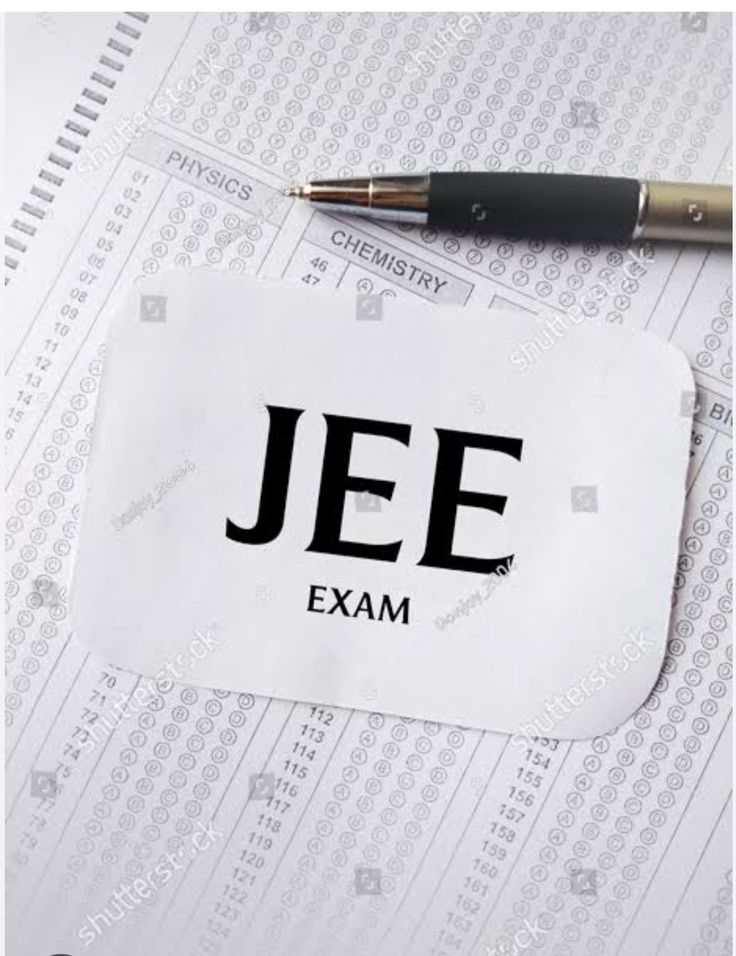

**Official website:** https://jeemain.nta.nic.in/

## Overview

Joint Entrance Examination (Main), commonly called JEE Main, is a national entrance examination conducted by the National Testing Agency (NTA). It is used for admission to undergraduate engineering, architecture and planning programmes at participating institutions.

JEE Main 2027 has two sessions: Session 1 in January 2027 and Session 2 in April 2027. Candidates may apply for one or both sessions. If a candidate appears in both sessions, NTA uses the better total NTA score for the final merit/ranking process, as described in the applicable bulletin. Paper 1 is for B.E./B.Tech; Paper 2A is for B.Arch; Paper 2B is for B.Planning.

JEE Main Paper 1 is also the qualifying examination for JEE Advanced. A JEE Main score is not, by itself, an IIT admission offer. Candidates seeking an IIT seat must qualify for and appear in JEE Advanced, then take part in the applicable seat-allocation process.

## Who can apply?

### Educational qualification for JEE Main 2027

According to the JEE Main 2027 official FAQ, candidates who have passed Class 12 or an equivalent examination in **2025 or 2026**, or who are appearing in Class 12 in **2027**, may appear for JEE Main 2027. This rule applies irrespective of age.

Recognised qualifying examinations include Class 12 examinations conducted by recognised Central or State Boards and specified equivalent examinations. Candidates with an equivalent qualification from outside India or from a board not listed in the bulletin may need an equivalence certificate from the Association of Indian Universities (AIU).

### Age limit

- **There is no age limit to appear for JEE Main 2027**, according to the official 2027 FAQ.
- However, the institute to which a candidate seeks admission may have its own age or other admission conditions. Check the institute's rules and the current JoSAA business rules.

### Number of attempts

The 2027 eligibility FAQ defines the qualifying examination window as the Class 12 passing years 2025 and 2026, or appearing in 2027. JEE Main has two sessions in the 2027 examination cycle. The FAQ does not state a separate lifetime attempt cap in its answer; candidates should use the year-of-passing rule in the 2027 bulletin rather than assume that JEE Advanced attempt limits also apply to JEE Main.

### Important difference: appearing for JEE Main vs getting an NIT/IIIT seat

Meeting the JEE Main examination eligibility rules does not automatically make a candidate eligible for every institute.

For admission through the **NIT+ System** (NITs, IIEST, IIITs and Other-GFTIs), the 2026 JoSAA rules required candidates to satisfy a Class 12 performance condition as well as obtain the relevant JEE Main rank. The 2026 condition was either:

- at least **75% aggregate marks** in Class 12 (65% for SC, ST and PwD candidates), or
- placement within the category-wise **top 20 percentile** of successful candidates in the relevant board examination.

Candidates must also pass the required subjects for the programme. For B.E./B.Tech, the 2026 rules specified Physics, Mathematics, one of Chemistry/Biology/Biotechnology/Technical Vocational subject, a language and one other subject for the five-subject calculation. These are **2026 admission rules**; confirm the 2027 JoSAA rules when published.

IIT admission has its own Class 12 performance and subject conditions under the JEE Advanced/JoSAA rules. Do not treat the JEE Main exam eligibility rule as the full admission eligibility rule.

## Important dates

### JEE Main 2027

| Event                                   | Official date / status                    |
| --------------------------------------- | ----------------------------------------- |
| Session 1 application opens             | 24 October 2026                           |
| Regular Session 1 application deadline  | 22 November 2026, 11:50 p.m.              |
| Late application window                 | 23–26 November 2026, 11:50 p.m.           |
| Last date for late-fee payment          | 26 November 2026, 11:50 p.m.              |
| Session 1 application correction window | 27–29 November 2026                       |
| Advance city intimation                 | 30 December 2026                          |
| Admit card download                     | 13 January 2027                           |
| Session 1 examination                   | 20, 21, 22, 23, 24 and 28 January 2027    |
| Session 2                               | April 2027; exact dates **Not announced** |
| Session 2 application window            | **Not announced**                         |
| Session 2 city intimation / admit card  | **Not announced**                         |
| Final result / All India Rank for 2027  | **Not announced**                         |

**Status note dated 24 November 2026:** The regular Session 1 application deadline has passed. NTA's 30 October 2026 clarification permits a fresh Session 1 application with late fee from 23 to 26 November 2026. The correction window is scheduled for 27–29 November 2026. Read the clarification carefully: a fee paid for an earlier application is not refunded or adjusted against a fresh application. Candidates must not appear more than once in the same session using multiple application numbers.

Dates can be revised by NTA. Check the official website before making plans.

## Application process step by step

1. **Open the official portal.** Visit https://jeemain.nta.nic.in/ and select the active JEE Main 2027 session application link.
2. **Read the 2027 Information Bulletin.** Check eligibility, paper selection, fee, photograph and signature rules, identity verification and required documents.
3. **Register.** Create the application account using the permitted identity and contact details. NTA's 28 October 2026 advisory recommends using the candidate's own DigiLocker, JanParichay or e-Pramaan credentials and completing DigiLocker re-KYC.
4. **Fill in personal and academic details.** Enter the candidate's name and date of birth exactly as recorded on the Class 10 certificate/marksheet. Enter the Class 12 status and state code of eligibility carefully.
5. **Choose the paper(s) and exam medium.** Select Paper 1, Paper 2A, Paper 2B or the permitted combination. Check the 2027 bulletin for the available combination and fee.
6. **Upload documents.** Upload the live photograph, signature and any required category/PwD or other certificates in the specified format.
7. **Pay the examination fee.** Use an online payment method accepted on the NTA portal. Keep the transaction record.
8. **Download the confirmation page.** An application is not complete until the fee is successfully paid and the confirmation page is generated.
9. **Check notices and correction dates.** Use the correction facility only for the fields NTA permits. Do not submit multiple forms to try to obtain multiple sittings in the same session.
10. **Download the city slip and admit card.** These are released separately. The city intimation slip is not the admit card.

## Application fee

JEE Main 2027 application fees are **paper-, category-, gender- and examination-centre dependent**. The official 2027 Information Bulletin contains the fee table. The exact 2027 fee amounts could not be independently extracted from the accessible official bulletin during preparation of this page, so the fee figures are marked **Not verified** rather than copied from an older cycle.

- Check the 2027 Information Bulletin under the application-fee section before payment.
- The amount shown on the live NTA payment page for the candidate's chosen paper(s) and category is the amount to pay.
- Bank/payment gateway charges and applicable GST may be additional.
- Do not use a 2024, 2025 or 2026 fee chart as proof of the 2027 fee.

Official bulletin and notices: https://jeemain.nta.nic.in/documents/

## Exam pattern

JEE Main 2027 has three paper types. The 2027 public notice confirms the papers, question counts and section structure. Check the 2027 Information Bulletin for the full detailed marking and examination rules.

### Paper 1: B.E. / B.Tech

| Subject     | Section A: MCQs | Section B: Numerical-value questions | Total questions |
| ----------- | --------------: | -----------------------------------: | --------------: |
| Mathematics |              20 |                                    5 |              25 |
| Physics     |              20 |                                    5 |              25 |
| Chemistry   |              20 |                                    5 |              25 |
| **Total**   |          **60** |                               **15** |          **75** |

- **Mode:** Computer Based Test (CBT).
- **Duration:** 3 hours.
- **Maximum marks:** 300.
- **Marking:** The 2027 notice confirms negative marking in both Section A and Section B. The detailed marks per correct/incorrect answer should be checked in the 2027 Information Bulletin; the standard scheme in recent JEE Main cycles has been +4 for a correct answer and −1 for an incorrect answer, but confirm the 2027 bulletin before relying on it.

### Paper 2A: B.Arch

| Part      | Subject       |                                  Questions |
| --------- | ------------- | -----------------------------------------: |
| Part I    | Mathematics   | 25 (20 MCQs + 5 numerical-value questions) |
| Part II   | Aptitude Test |                                         50 |
| Part III  | Drawing Test  |                                          2 |
| **Total** |               |                                     **77** |

- **Mode:** CBT for Mathematics and Aptitude; drawing test is offline, pen-and-paper on an A4 drawing sheet.
- **Duration:** 3 hours.
- **Maximum marks:** 400.
- The drawing component tests visualisation and drawing ability. Refer to the 2027 bulletin for its evaluation details and marking rules.

### Paper 2B: B.Planning

| Part      | Subject                  |                                  Questions |
| --------- | ------------------------ | -----------------------------------------: |
| Part I    | Mathematics              | 25 (20 MCQs + 5 numerical-value questions) |
| Part II   | Aptitude Test            |                                         50 |
| Part III  | Planning-based questions |                                         25 |
| **Total** |                          |                                    **100** |

- **Mode:** CBT.
- **Duration:** 3 hours.
- **Maximum marks:** 400.

Candidates taking both Paper 2A and Paper 2B in the same sitting have a combined examination duration of 3 hours 30 minutes, as stated in the 2027 public notice.

## Syllabus summary

NTA has published a separate **JEE Main 2027 syllabus**. The following is a short overview; it is not a substitute for the official unit-wise syllabus.

### Paper 1: B.E. / B.Tech

- **Mathematics:** Sets, relations and functions; complex numbers; matrices and determinants; permutations and combinations; binomial theorem; sequences and series; calculus; differential equations; coordinate geometry; three-dimensional geometry; vectors; statistics and probability; trigonometry.
- **Physics:** Units and measurements; kinematics; laws of motion; work, energy and power; rotational motion; gravitation; properties of solids and liquids; thermodynamics; kinetic theory; oscillations and waves; electrostatics; current electricity; magnetism; electromagnetic induction and alternating currents; electromagnetic waves; optics; dual nature of matter; atoms and nuclei; electronic devices; experimental skills.
- **Chemistry:** Physical chemistry, inorganic chemistry and organic chemistry. Topics include basic concepts, atomic structure, chemical bonding, thermodynamics, solutions, equilibrium, electrochemistry, chemical kinetics, periodicity, p-block and d/f-block elements, coordination compounds, purification and characterisation of organic compounds, hydrocarbons, oxygen- and nitrogen-containing compounds, biomolecules and practical chemistry.

### Paper 2A: B.Arch

- Mathematics
- Aptitude Test
- Drawing Test

### Paper 2B: B.Planning

- Mathematics
- Aptitude Test
- Planning-based questions

Download the official unit-wise 2027 syllabus from: https://jeemain.nta.nic.in/documents/

## Preparation tips

1. **Use the official 2027 syllabus as your checklist.** Do not spend time on topics that are not in the current syllabus without first covering the listed units.
2. **Build fundamentals.** Strengthen concepts in Physics, Chemistry and Mathematics before moving to timed practice.
3. **Practise with official question papers.** Use previous JEE Main papers and the official answer keys to understand question style and time pressure.
4. **Take timed mock tests.** Practise completing the paper within the actual examination duration.
5. **Review every mistake.** Record whether the error came from a concept gap, calculation, misreading or poor time management.
6. **Balance the three subjects.** Avoid depending only on the subject in which you score best.
7. **Practise numerical questions.** Section B also carries negative marking under the 2027 public notice.
8. **For B.Arch, practise drawing and visual composition.** The drawing test is not a CBT section.
9. **For B.Planning, practise planning awareness and aptitude.** Use the official Paper 2B syllabus.
10. **Keep documents ready.** Check the photograph, signature, identity details and category certificates before applying.

## Admit card and results

### Admit card

NTA publishes an examination city intimation slip and an admit card separately. The city slip tells candidates the city allotted for the examination; it is not a substitute for the admit card.

For JEE Main 2027 Session 1, the NTA public notice lists 13 January 2027 as the scheduled admit-card download date. Candidates should download the admit card from the official portal, read the reporting instructions and carry the documents specified by NTA.

### Results and NTA scores

NTA publishes session-wise scores and the final result through the official JEE Main portal. The score is expressed as an NTA percentile score; it is not the same as the percentage of marks obtained.

For candidates who take both sessions, the best total NTA score is used for the final merit/ranking process, as described in the examination rules. NTA publishes separate results for Paper 1 and Paper 2.

Candidates should use only the final NTA result and official rank information for counselling. Coaching-centre predictions are not official results.

## Counselling process

### JoSAA counselling

JoSAA (Joint Seat Allocation Authority) conducts the joint seat-allocation process for IITs, IISc, NITs, IIEST, IIITs and Other-GFTIs. For 2026–27, JoSAA stated that its process covered 138 institutions: 23 IITs, IISc Bengaluru, 31 NITs, IIEST Shibpur, 26 IIITs and 56 Other-GFTIs. The 2027 institution list and seat matrix must be checked when published.

The admission routes are:

- **IITs and IISc:** JEE Advanced rank, plus the applicable Class 12 and institute eligibility conditions.
- **NITs, IIEST, IIITs and Other-GFTIs:** JEE Main rank in the relevant paper, plus the applicable Class 12 and institute eligibility conditions.
- **B.Arch and B.Planning:** The relevant Paper 2A or Paper 2B rank for participating programmes.

### Typical JoSAA steps

1. Register on the official JoSAA portal when registration opens.
2. Fill in institute and programme choices in order of preference.
3. Lock choices before the deadline, or follow the system-locking rule if choices are not locked.
4. Check the mock allocation and round-wise seat-allocation results.
5. If a seat is allotted, upload documents, submit the required willingness option (Freeze, Float or Slide, where applicable) and pay the seat acceptance fee.
6. Complete online reporting and respond to any document-verification query.
7. Follow the instructions for institute reporting and any remaining fee.
8. If eligible and interested in vacant seats in the NIT+ system after JoSAA, check the separate CSAB counselling notices.

JoSAA is not the only counselling route for every institution that accepts JEE Main. Some participating state universities and private institutions have their own admission process. Always check the institution's official admission notice.

Official counselling portal: https://josaa.nic.in/  
CSAB: https://csab.nic.in/

## Colleges accepting this exam

JEE Main scores are used by several groups of institutions, subject to each programme's eligibility and admission rules.

### NITs

National Institutes of Technology use JEE Main Paper 1 for B.E./B.Tech admission through JoSAA. NITs also offer selected architecture and planning programmes through the relevant Paper 2 scores.

### IIITs

Participating Indian Institutes of Information Technology use JEE Main scores for their listed undergraduate programmes through JoSAA or the applicable admission route.

### Other CFTIs and GFTIs

Other Centrally Funded Technical Institutions and Government Funded Technical Institutes listed in the JoSAA seat matrix use the relevant JEE Main paper for the programmes they offer.

### State and other participating institutions

Some state-funded universities and institutions use JEE Main scores. Other government, private and deemed universities may also accept JEE Main, but this is not universal. Check each institution's official admission page.

### IITs

IITs do **not** offer regular undergraduate admission based only on JEE Main. Candidates must qualify for JEE Advanced, meet its eligibility conditions and participate in JoSAA for IIT seat allocation.

## Cutoff trends (official sources only)

There are different meanings of "cutoff" in JEE Main:

1. **JEE Advanced qualifying cutoff:** The category-wise JEE Main percentile required to become eligible to appear for JEE Advanced.
2. **College admission closing rank:** The last rank at which a particular institute and programme offered a seat in a specific JoSAA round and category.

These figures are not interchangeable.

### JEE Advanced eligibility cutoffs

The following are the official NTA category-wise minimum NTA scores for eligibility to JEE Advanced, not NIT/IIIT admission cutoffs.

| Category     | 2025 percentile | 2026 percentile |
| ------------ | --------------: | --------------: |
| General / UR |      93.1023262 |      93.4123549 |
| General-EWS  |      80.3830119 |      82.4164528 |
| OBC-NCL      |      79.4313582 |      80.9232583 |
| SC           |      61.1526933 |      63.9172792 |
| ST           |      47.9026465 |      52.0174712 |

The PwBD subcategory has separate treatment in the official result notices; candidates should check the category-specific result table rather than apply the General category value to every PwBD candidate.

### JoSAA opening and closing ranks

For actual college and branch choices, use JoSAA's official opening and closing rank data. It is published by institute, programme, round, category, gender pool and quota. A single “JEE Main cutoff” cannot represent all colleges.

Official data:

- 2026 opening and closing ranks: https://josaa.nic.in/or-cr/
- 2026 JoSAA business rules: https://josaa.nic.in/information-bulletin/

## Frequently asked questions

### 1. Is JEE Main conducted by NTA?

Yes. The Ministry of Education has entrusted NTA with conducting JEE Main. NTA publishes the application notices, information bulletin, syllabus, admit cards, answer keys and results on the official JEE Main website.

### 2. How many sessions are there in JEE Main 2027?

NTA has announced two sessions: Session 1 in January 2027 and Session 2 in April 2027. The exact Session 2 dates and application window are not announced in the published schedule as of 24 November 2026.

### 3. Can I get admission to an IIT through JEE Main?

Not directly. JEE Main Paper 1 is used to shortlist candidates for JEE Advanced. IIT admission requires qualifying JEE Advanced, meeting the additional eligibility conditions and participating in JoSAA seat allocation.

### 4. Does JEE Main guarantee admission to an NIT or IIIT?

No. A candidate needs the relevant JEE Main rank and must satisfy the Class 12 performance, subject, category and institute-specific requirements. Seat allocation also depends on choices, category, quota, seat availability and rank.

### 5. If I take both sessions, which score is considered?

For candidates who appear in both sessions, the better total NTA score is used for the final merit/ranking process under the applicable examination rules. Check the 2027 Information Bulletin for the official score compilation procedure.

## Sources

All sources below are official exam-body or government/institutional portals. Information refers to the 2027 cycle unless a previous year is stated.

1. **JEE Main official website (NTA):**  
   https://jeemain.nta.nic.in/
2. **JEE Main 2027 documents page** (2027 Information Bulletin, application notices and syllabus):  
   https://jeemain.nta.nic.in/documents/
3. **NTA public notice dated 24 October 2026** — Session 1 dates, paper descriptions, examination mode and question distribution:  
   https://cdnbbsr.s3waas.gov.in/s3f8e59f4b2fe7c5705bf878bbd494ccdf/uploads/2026/10/20261024390682350.pdf
4. **NTA public notice dated 28 October 2026** — registration advisory for JEE Main 2027:  
   https://cdnbbsr.s3waas.gov.in/s3f8e59f4b2fe7c5705bf878bbd494ccdf/uploads/2026/10/202610281658843201.pdf
5. **NTA public notice dated 30 October 2026** — fresh application, late-fee and correction-window clarification:  
   https://nta.ac.in/Download/Notice/Notice_20261030202143.pdf
6. **JEE Main 2027 syllabus:**  
   https://cdnbbsr.s3waas.gov.in/s3f8e59f4b2fe7c5705bf878bbd494ccdf/uploads/2026/10/20261024683680768.pdf
7. **JEE Main 2027 FAQs** — age and qualifying-examination years:  
   https://cdnbbsr.s3waas.gov.in/s3f8e59f4b2fe7c5705bf878bbd494ccdf/uploads/2026/11/202611201718701424.pdf
8. **JEE Advanced 2027 eligibility:**  
   https://jeeadv.ac.in/eligibility.html
9. **JoSAA 2026 official portal and participating-institute overview:**  
   https://josaa.nic.in/
10. **JoSAA 2026 Business Rules** — admission routes, institute categories and Class 12 conditions for the 2026–27 cycle:  
    https://cdnbbsr.s3waas.gov.in/s313111c20aee51aeb480ecbd988cd8cc9/uploads/2026/06/20260601632081678.pdf
11. **JoSAA opening and closing ranks:**  
    https://josaa.nic.in/or-cr/
12. **NTA JEE Main 2026 result notice** — 2026 JEE Advanced qualifying percentiles:  
    https://nta.ac.in/Download/Notice/Notice_20260420194021.pdf
13. **NTA JEE Main 2025 result notice** — 2025 JEE Advanced qualifying percentiles:  
    https://nta.ac.in/Download/Notice/Notice_20250419125449.pdf
14. **Central Seat Allocation Board (CSAB):**  
    https://csab.nic.in/

## Not verified

- The exact JEE Main 2027 application fee amounts for every gender, category, paper combination and examination-centre location. Use the fee table in the 2027 Information Bulletin and the live payment page.
- The exact Session 2 (April 2027) examination dates, application dates, city-intimation date and admit-card date.
- The 2027 JoSAA participating-institute list, seat matrix, business rules, counselling schedule and programme-specific closing ranks.
- The 2027 JoSAA Class 12 admission conditions. The 75% / 65% or top-20-percentile conditions described above are from the 2026 rules and must be rechecked for 2027.
- The exact 2027 marks awarded for every correct, incorrect and unanswered question in each paper section; candidates should confirm the marking table in the 2027 Information Bulletin before the exam.
- Any individual college's use of JEE Main outside the official JoSAA participating-institute list; this must be checked on that institution's own admission website.
