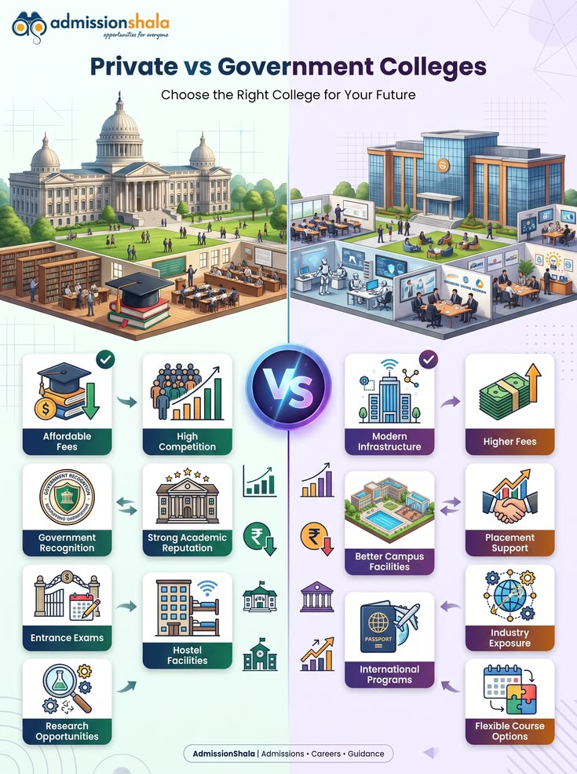

Choosing an engineering college is a major decision for students and parents. Government colleges and private colleges can both offer valuable learning experiences, but the quality, cost and opportunities differ from one institution to another. The college name alone is not enough to make a decision.

Instead of asking which type is always better, compare the specific colleges and branches available to you. This guide explains what to check before making a choice. Figures below are labelled with their relevant academic year.

## 1. Government and private colleges: What is the difference?

Government engineering colleges are established or funded by central or state governments. Examples include IITs, NITs, government engineering colleges and some state universities.

Private engineering colleges are run by private trusts, societies, companies or private universities. Their fee structures, admission processes and facilities vary widely.

Ownership does not automatically determine teaching quality, placement outcomes or student experience. A well-established private college may offer strong facilities and industry links, while a government college's quality also depends on its department, faculty and resources.

## 2. Government vs private engineering colleges: Comparison

| Factor              | Government colleges                                                                                                                                   | Private colleges                                                                                                                                                                                                                                      |
| ------------------- | ----------------------------------------------------------------------------------------------------------------------------------------------------- | ----------------------------------------------------------------------------------------------------------------------------------------------------------------------------------------------------------------------------------------------------- |
| **Fees range**      | Not verified as one national range. Fees differ by institute, category, income-based waiver and hostel choice. Check the current official fee notice. | Not verified as one national range. As one example, VIT's published 2026–27 B.Tech tuition categories range from ₹1.73 lakh to ₹4.90 lakh per year, depending on programme group and fee category. This is an example, not a private-college average. |
| **Admission route** | May include JEE Main/Advanced, JoSAA/CSAB, state entrance exams or state counselling, depending on the institution.                                   | May include state counselling, national/state entrance tests, or the institution's own admission process. Check the specific college's official rules.                                                                                                |
| **Placements**      | Outcomes differ by institution, branch and graduating batch. Review official branch-wise reports and median salary, not only the highest package.     | Also vary by institution, branch and batch. Ask for eligible students, students placed, median salary and the reporting year.                                                                                                                         |
| **Campus**          | Facilities differ. Some have large campuses and extensive laboratories; others may have more limited infrastructure.                                  | Facilities differ too. Check laboratories, workshops, library, hostels, internet and access to equipment in person or through an official campus tour.                                                                                                |
| **Faculty**         | Check permanent faculty strength, qualifications, experience and faculty availability in your chosen department.                                      | Apply the same checks. Do not assume that a private or government label guarantees better teaching.                                                                                                                                                   |
| **Brand value**     | Some government institutions have long-established recognition, but reputation varies across colleges and branches.                                   | Some private institutions have strong national or regional recognition. Verify reputation through rankings, accreditation, alumni and employer engagement.                                                                                            |

**Fee example source:** VIT's official 2026–27 B.Tech fee schedule lists tuition categories by programme group and fee category. The published figures are annual tuition amounts and should not be treated as a sector-wide range. Hostel, mess, deposits and other charges may be additional.

## 3. What to check before choosing any engineering college

### AICTE approval and legal status

Check the institution and the specific programme against the relevant approval and regulatory information. AICTE publishes an Approval Process Handbook and information about approved technical institutions. Also check whether the college is affiliated to a recognised university or is part of a university with the authority to award the degree.

Do not rely only on a logo or a claim on an admission brochure. Confirm the current academic year's approval or applicable regulatory status from official sources.

### NAAC grade and NBA accreditation

NAAC assesses and accredits higher education institutions. Check the institution's current accreditation status, grade, validity period and the exact campus or institution covered.

For engineering, also look for NBA accreditation of the specific programme. Institutional accreditation and programme accreditation are different, so one should not be used as a substitute for the other.

### NIRF rank

Use the Ministry of Education's National Institutional Ranking Framework (NIRF) as one comparison tool. Check the engineering category and the year of the ranking.

NIRF's 2025 engineering methodology considers teaching and learning resources, research, graduation outcomes, outreach and perception. It also includes placement and higher-study outcomes and median salary within its graduation-outcome measures. A rank is useful context, but it should not replace checking the department and course you plan to join.

### Official placement data

Read the college's own placement report or mandatory disclosure. Look for:

- Number of students eligible for placement.
- Number of students placed.
- Branch-wise placement information.
- Median salary, where published.
- Number of companies and the roles offered.
- Internship information and the year covered.

A highest salary figure may represent one student or a special offer. It does not describe the experience of the entire batch. If a college does not publish enough detail to verify its claims, mark the information as **Not verified** and ask the admissions office for written clarification.

### Total cost and course fit

Calculate the full four-year cost, not just first-year tuition. Include hostel, food, transport, examination fees, deposits, laptop and other compulsory charges. Ask about fee increases and refund rules.

Finally, compare the curriculum, elective options, laboratories, student projects and internship support for your preferred branch. A college should be evaluated for the programme you will actually study.

## 4. Common mistakes students and parents should avoid

1. **Choosing only by ownership:** Government does not automatically mean high quality, and private does not automatically mean poor quality.
2. **Focusing only on the highest package:** Ask for placement numbers, median salary and branch-wise outcomes.
3. **Ignoring the branch:** A college's overall reputation may not reflect the department you are considering.
4. **Overlooking the total cost:** Hostel, food, travel and other charges can change the financial decision.
5. **Trusting unverified claims:** Confirm approval, accreditation, rankings, scholarships and placement statistics through official documents.
6. **Missing admission conditions:** Check entrance requirements, counselling rules, category eligibility, deadlines and refund policies.

## 5. Key takeaways

> **Key takeaways**
>
> - There is no universal winner between government and private engineering colleges.
> - Compare individual colleges, departments and branches rather than relying on labels.
> - Verify AICTE approval or applicable regulatory status, NAAC accreditation and programme-level NBA accreditation where relevant.
> - Use NIRF rankings as one reference, not the only decision factor.
> - Review official, year-specific and branch-wise placement data.
> - Compare the complete cost of the degree before accepting an offer.

## 6. Frequently asked questions

### 1. Are government engineering colleges always cheaper?

Not always in every comparison. Fees depend on the institution, category, scholarships, income-based waivers and additional charges. Compare the official fee schedules for the exact colleges and admission categories.

### 2. Can a private engineering college have good placements?

Yes. Placement outcomes vary across individual institutions and departments. Check official reports for the number eligible, number placed, median salary, branch-wise data and reporting year before drawing a conclusion.

### 3. Is NAAC accreditation enough to judge an engineering college?

No. NAAC evaluates the institution, while NBA accreditation relates to specific programmes. Also review AICTE or applicable regulatory status, faculty, curriculum, laboratories, NIRF information and official placement data.

### 4. Should I choose a better-ranked college or my preferred branch?

There is no single answer for every student. Compare the curriculum, department quality, career paths, fees and your interest in the subject. A ranking is one input; it should not decide the choice by itself.

## Get free engineering admission counselling

Not sure how to compare your college options, branches and admission routes? Get free counselling guidance to review your choices and make an informed engineering admission decision.

---

## Sources

### Five key official sources researched

1. **AICTE – Approval Process Handbook 2024–25 to 2026–27**  
   https://aicte-qa.aicte-india.org/sites/default/files/APH%20Final.pdf

2. **UGC – National Assessment and Accreditation Council (NAAC)**  
   https://www.ugc.gov.in/Aboutus/NAAC

3. **Ministry of Education – NIRF India Rankings 2025: Engineering**  
   https://www.nirfindia.org/Rankings/2025/EngineeringRanking.html

4. **NIRF – India Rankings 2025 Engineering Methodology**  
   https://www.nirfindia.org/nirfpdfcdn/2025/framework/Engineering.pdf

5. **VIT – Official B.Tech Fee Structure, Academic Year 2026–27**  
   https://vit.ac.in/admission/ug/fee-structure

### Additional official reference

- **UGC – AICTE's role and professional councils**  
  https://www.ugc.gov.in/UGCofficials/Professional_Councils

## Not verified

- A single nationwide government-college or private-college engineering fee range.
- A reliable government-versus-private national placement average.
- Any claim that one ownership category consistently has better faculty, campus facilities or brand value.
- College-specific approval, accreditation, fees and placement claims not checked against the current official documents for that institution and programme.

**Editorial note:** Before publication for a later admission year, refresh the AICTE approval status, accreditation validity, NIRF ranking year and each college's latest fee and placement disclosures.
