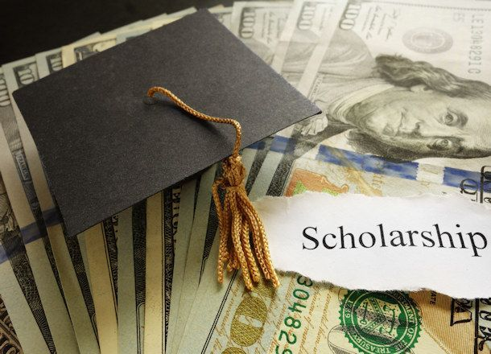

Scholarships and fee waivers can make education more affordable for students and families. Some are awarded for academic performance, while others support students based on family income, community, disability, region or course of study.

The challenge is finding a genuine scheme and understanding its actual conditions. This guide introduces government scholarship options, explains how to apply through the National Scholarship Portal (NSP), and highlights warning signs of fake offers. Scheme details and amounts can change, so always read the latest official notification before applying.

## 1. Scholarships Indian students can explore

The table below lists real schemes published by government departments or statutory bodies. Eligibility is summarised; it is not a substitute for the full scheme guidelines. Amounts are included only where an official source located for this article states them clearly. Where the current-cycle amount could not be confirmed, it is marked **Not verified**.

| Scholarship                                                                            | Provider                                     | Who can apply                                                                                                                        | Benefit                                                                                                                                                                                                | Official link                                                                                                                      |
| -------------------------------------------------------------------------------------- | -------------------------------------------- | ------------------------------------------------------------------------------------------------------------------------------------ | ------------------------------------------------------------------------------------------------------------------------------------------------------------------------------------------------------ | ---------------------------------------------------------------------------------------------------------------------------------- |
| PM-USP Central Sector Scheme of Scholarship for College and University Students (CSSS) | Ministry of Education                        | Meritorious Class 12 students meeting the board percentile, income and regular-course conditions in the scheme guidelines            | Published guideline rate: ₹12,000 per year for the first three years and ₹20,000 for the fourth year of eligible technical courses such as B.Tech. Confirm the applicable rate for your academic year. | [Scheme guidelines](https://www.education.gov.in/sites/upload_files/mhrd/files/upload_document/PM_USP_CSSS_guidelines_updated.pdf) |
| Ishan Uday Special Scholarship Scheme                                                  | UGC                                          | First-year regular UG students from the North Eastern Region who meet the Class 12, income and course conditions                     | UGC scheme page lists ₹80,000 per year. Confirm current-cycle availability and conditions.                                                                                                             | [UGC scheme page](https://www.ugc.gov.in/Scholarships/stu_Scholarship5)                                                            |
| AICTE Pragati Scholarship for Girl Students (Technical Degree/Diploma)                 | AICTE                                        | Eligible girl students admitted to approved technical degree or diploma programmes, subject to scheme conditions                     | Scholarship support for technical education; 2026–27 amount: **Not verified** from the official material checked.                                                                                      | [NSP scheme list](https://scholarships.gov.in/All-Scholarships)                                                                    |
| AICTE Saksham Scholarship (Technical Degree/Diploma)                                   | AICTE                                        | Eligible specially abled students admitted to approved technical degree or diploma programmes                                        | Financial support under the scheme; 2026–27 amount: **Not verified** from the official material checked.                                                                                               | [NSP scheme list](https://scholarships.gov.in/All-Scholarships)                                                                    |
| AICTE Swanath Scholarship (Technical Degree/Diploma)                                   | AICTE                                        | Students meeting the scheme's specified vulnerable-background criteria and enrolled in eligible technical programmes                 | Financial support for eligible technical students; 2026–27 amount: **Not verified** from the official material checked.                                                                                | [NSP scheme list](https://scholarships.gov.in/All-Scholarships)                                                                    |
| Top Class Education for SC Students                                                    | Department of Social Justice and Empowerment | Eligible SC students pursuing post-Class 12 studies in institutions notified under the scheme                                        | Support can include tuition and eligible fees, living expenses and other specified assistance. Exact 2026–27 benefit depends on the guidelines and institution; amount: **Not verified** here.         | [Official scheme and 2026–27 guidelines](https://socialjustice.gov.in/schemes/27)                                                  |
| National Scholarship for Higher Education of ST Students (Top Class)                   | Ministry of Tribal Affairs                   | Eligible ST students admitted to notified premier institutions; the ministry page states a family-income ceiling of ₹6 lakh per year | Support includes tuition and specified fees, stipend and allowances for books and computer. Confirm current rates in the latest guidelines.                                                            | [Ministry scheme page](https://tribal.nic.in/Scholarship.aspx)                                                                     |
| Top Class Education for OBC, EBC and DNT Students (College)                            | Department of Social Justice and Empowerment | Eligible OBC, EBC and DNT students admitted to institutions covered by the scheme                                                    | Financial assistance under the top-class college education sub-scheme; 2026–27 amount: **Not verified** from the official material checked.                                                            | [PM-YASASVI scheme page](https://socialjustice.gov.in/schemes/101)                                                                 |

**Important:** Being listed on NSP does not mean every student qualifies. Some schemes have limited slots, notified-institution lists, income ceilings, course restrictions or rules against receiving another scholarship for the same purpose. Check the current academic-year notice and the scheme's detailed guidelines.

## 2. How to apply through the National Scholarship Portal

The National Scholarship Portal brings together schemes from several central ministries, departments and other authorities. The portal currently displays schemes for academic year 2026–27. It also states that One Time Registration (OTR) is mandatory.

Follow these steps:

### Step 1: Find a suitable scheme

Visit [scholarships.gov.in](https://scholarships.gov.in/) and open the student or all-scholarships section. Filter by ministry, scheme or eligibility. Read the scheme specifications and FAQs before starting.

### Step 2: Complete One Time Registration

Create your OTR using the official portal's instructions. Keep your details accurate and use your own valid contact information. Do not share your password or OTP with anyone claiming to be an agent.

### Step 3: Sign in and complete the application

Select the relevant academic year and scheme. Enter personal, academic, institution and bank details exactly as required. Review every field before submitting.

### Step 4: Upload documents and submit

Upload clear, valid documents in the format requested by the portal. Save the application or reference number and download the acknowledgement if available.

### Step 5: Track verification

Your application may require verification by your educational institution and designated government officials. Track its status on NSP and respond to any correction request before the deadline.

**Deadlines:** They are scheme-specific and can change. The 2026–27 portal shows different closing dates for different schemes. Do not use a date from an old article or social media post; check the live scheme listing and official notices.

## 3. Documents usually needed

The exact document list differs by scholarship. Applicants may be asked for:

- Aadhaar or another accepted identity document, as specified.
- Recent passport-size photograph.
- Class 10 and Class 12 marksheets or other qualifying examination records.
- Current admission or bonafide certificate from the institution.
- Fee receipt, where required.
- Income certificate issued by the competent authority.
- Caste or community certificate, where applicable.
- Disability certificate or UDID details, where applicable.
- Domicile or residence certificate, where applicable.
- Bank account details and supporting proof in the student's name, as required by the scheme.

Check the official checklist before uploading. Do not send original certificates to an unknown person or social media account.

## 4. Warning signs of scholarship scams

Fake scholarship messages often use urgency, impressive amounts or official-sounding names to pressure students and parents. Be cautious if you notice any of these signs:

- **Guaranteed selection:** A caller promises a scholarship without checking eligibility or merit.
- **Payment demanded to release funds:** Someone asks for a processing, verification, registration or release charge through a personal UPI ID or bank account. Stop and verify directly with the scheme provider.
- **Requests for OTPs or passwords:** Never share your NSP password, banking PIN, OTP or other authentication details.
- **Unofficial links:** A message sends you to a lookalike website or asks you to install an unknown app.
- **Pressure to act immediately:** You are told that the offer will disappear unless you pay or share documents at once.
- **Unverifiable contact details:** The sender uses a personal email address or phone number that does not match the official department's published contact information.

Do not trust a message simply because it contains your name, school or course details. Open the official website yourself and confirm whether the scheme and announcement exist.

If you suspect online financial fraud, contact your bank promptly and report it through the [National Cyber Crime Reporting Portal](https://cybercrime.gov.in/) or call **1930**. Keep screenshots, transaction details, phone numbers and messages as evidence.

## 5. Key takeaways

> **Key takeaways**
>
> - Check government and institutional scholarship schemes against their official guidelines.
> - Match your course, income, category, location and institution to the eligibility conditions.
> - NSP states that OTR is mandatory for scholarship applications on the portal.
> - Deadlines and benefits vary by scheme and academic year.
> - Never share OTPs, passwords or banking PINs with a scholarship agent.
> - Verify an offer independently before submitting documents or making a payment.

## 6. Frequently asked questions

### 1. Can I apply for more than one scholarship?

It depends on the scheme rules. Some allow certain combinations, while others do not permit another scholarship or fee reimbursement for the same period or purpose. NSP's 2026–27 student information says applicants may apply for one merit-based scheme and one or more welfare-based schemes, subject to each scheme's eligibility criteria. Always check the rules of the specific schemes.

### 2. Is the National Scholarship Portal only for college students?

No. NSP lists schemes for different education levels, including school and higher education. The available schemes depend on the academic year and the student's eligibility.

### 3. Are scholarship deadlines the same every year?

No. Dates can change by scheme and academic year. Use the live NSP listing and the concerned ministry's official notice rather than relying on an old deadline.

### 4. What should I do if someone claims I have won a scholarship and asks for money?

Do not pay or share OTPs, passwords or banking PINs. Verify the offer through the official scheme provider. If money has already been transferred in an online fraud, contact your bank immediately and report it through cybercrime.gov.in or 1930.

## Get free scholarship guidance

Not sure which scholarship matches your eligibility or how to complete your application? Get free counselling guidance to identify suitable schemes and understand the official application process.

---

## Sources

### Five best official sources researched

1. **National Scholarship Portal (NSP)** – Scheme listings, academic-year information, OTR requirement and application updates.  
   https://scholarships.gov.in/Students  
   https://scholarships.gov.in/All-Scholarships

2. **Ministry of Education – PM-USP CSSS Guidelines** – Eligibility, application process and published scholarship rates.  
   https://www.education.gov.in/sites/upload_files/mhrd/files/upload_document/PM_USP_CSSS_guidelines_updated.pdf

3. **University Grants Commission (UGC) – Ishan Uday** – Regional eligibility, income condition and financial assistance.  
   https://www.ugc.gov.in/Scholarships/stu_Scholarship5

4. **Department of Social Justice and Empowerment – Top Class Education for SC Students** – Scheme information and 2026–27 guidelines.  
   https://socialjustice.gov.in/schemes/27

5. **National Cyber Crime Reporting Portal** – Reporting online financial fraud and suspicious cyber activity.  
   https://cybercrime.gov.in/

### Additional official scheme references

- **Ministry of Tribal Affairs – Scholarships**  
  https://tribal.nic.in/Scholarship.aspx
- **Department of Social Justice and Empowerment – PM-YASASVI**  
  https://socialjustice.gov.in/schemes/101
- **NSP – Terms and Conditions / Portal information**  
  https://scholarships.gov.in/terms-conditions
- **Indian Cyber Crime Coordination Centre – Report financial cyber fraud**  
  https://cybercrime.gov.in/webform/crime_nodalgrivancelist.aspx

## Not verified

- The 2026–27 benefit amounts for AICTE Pragati, Saksham and Swanath from the official material checked for this article.
- The exact 2026–27 benefit amount for the SC, ST and OBC/EBC/DNT top-class schemes in every eligible institution and course.
- Any 2027–28 application opening or closing date.
- Whether a student will receive an award; selection depends on scheme conditions, verification, available slots and official approval.

**Editorial note:** Recheck the live NSP listing and the latest ministry or UGC guidelines before publishing updates for a new academic year.
